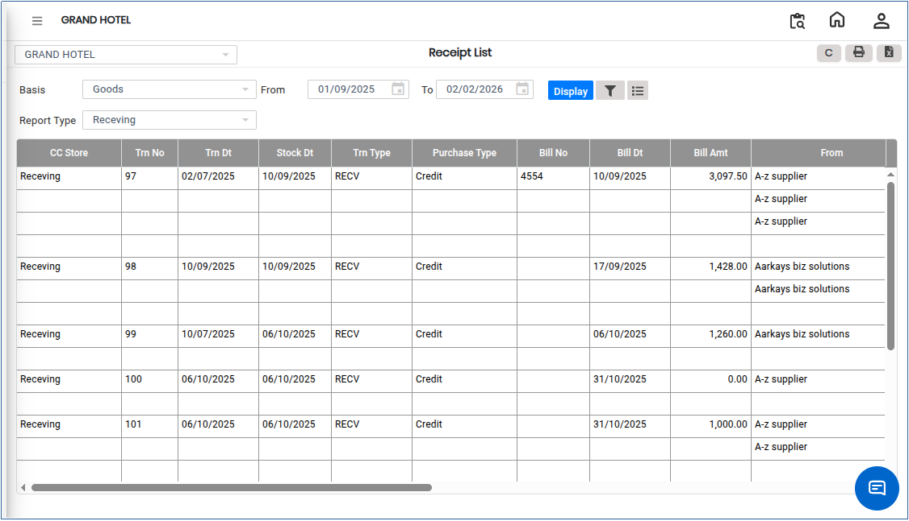

# Receipt List

The **Receipt List Report** provides a comprehensive list of all **MRN (Material Receipt Note)** and **GRN (Goods Receipt Note)** transactions recorded in the system.

This report enables users to view received items either **Store-wise** or as a **Consolidated Report** for a selected period. Additional information such as **Supplier Name**, **Bill Number**, **Receipt Date**, and other transaction details can also be viewed.

## Steps to View the Receipt List Report

Step 1: Navigate to the **Reports** menu in the **Inventory** module.

1. Select **Receipt List**.

* The **Receipt list** screen will be displayed.

<figure><figcaption></figcaption></figure>

Step 2: Click the **Report Type** drop-down.

1. Choose the required report type based on your reporting needs.

<figure><figcaption></figcaption></figure>

Step 3: Click the **Advanced Filter** option available on the screen.

* Select the required filter criteria according to your reporting requirements.

<figure><figcaption></figcaption></figure>

Step &#x34;**:** Select the required **filter options.**

1. You can filter the report by **Product**, **Product Group**, and other available criteria, as shown below.

<figure><figcaption></figcaption></figure>

Step 5: After selecting the required filter options, click the **Display** button.

* The system will generate and display the filtered Receipt List Report.

<figure><figcaption></figcaption></figure>
