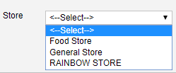
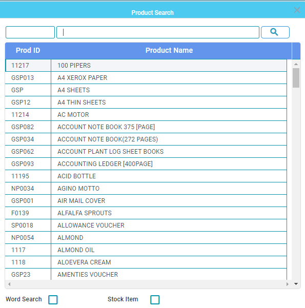
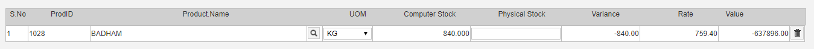

# Physical Inventory Reconciliation

**Physical Inventory Reconciliation**

What is **Physical Inventory Reconciliation ?**

**Inventory reconciliation** is the process of matching **inventory** records with the **physical inventory stock** held in your store or warehouse. When **inventory** discrepancies are found, **inventory** records are updated, or reconciled, to match the actual number of items in hand.

Steps to **Physical Inventory Reconciliation.**

1. Go to **Transaction Physical Inventory Reconciliation.**
2. The User Has to select the store, Screen shown below.

1. Once the User has Selected the store, click on the search icon to select the product list as shown below,

1. Once the user has selected the items which are not matching the user has to enter the quantity in the physical stock, as shown below.

1. After having entered the physical stock Quantity the user has to select the update stock check box as shown below.

1. Once the user has selected the update stock then click save.

.png>)
