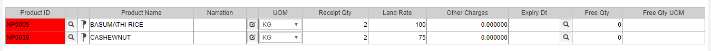
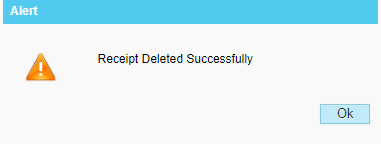

# Receipt Deletion

**Receipt Deletion**

What Is **Receipt Deletion?**

If the user has Mistakenly raised the Receipt or needs to delete a particular item from the receipt.

Steps to **Receipt Deletion**

1. Go to **Transaction Receipt Deletion.**
2. The User has to Select the Store, Screen shown below.

.png>)

1. Click On Receipt no to Select the Receipt note list as shown below.

.png>)

1. Once the user selected the receipt no, If you click the select all button it will select all the items in the list as shown below.

1. If you select the Delete Icon it will select the items to be deleted from the list.

.png>)

1. Once the user has selected the items in the receipt deletion then click save.

