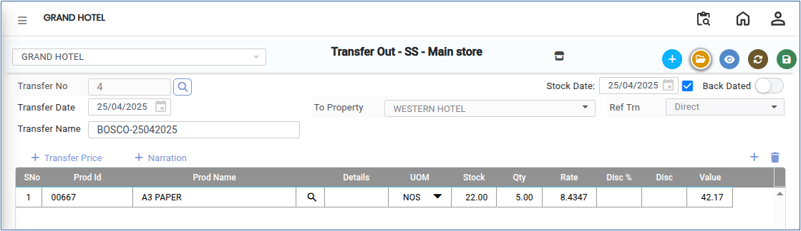

# Transfer Out

**Transfer Out** is the process of transferring inventory items from one store, warehouse, or property to another within the organisation.

## Steps to Perform Transfer Out

Step 1: Navigate to **Transactions** in the **Inventory** module.&#x20;

1. Select **Transfer Out**.

* The Transfer Out screen will be displayed.

<figure><figcaption></figcaption></figure>

Step 2: Enter or select the required **Transfer Out Property** details.

<figure><figcaption></figcaption></figure>

Step 3: Click the **Add** button.

1. Click the **Search** icon in the Product field.
2. A list of available products will be displayed.
3. Select the required product from the list.

* The selected product will be added to the Transfer Out transaction.

<figure><figcaption></figcaption></figure>

Step 4: Enter the quantity of the selected product to be transferred.

Step 5: Confirm that the destination **Transfer Store** has been selected correctly.

<figure><figcaption></figcaption></figure>

Step 6: Click the **Save** button..png>)

* The Transfer Out transaction will be successfully recorded, and the stock quantity will be reduced from the source store.
