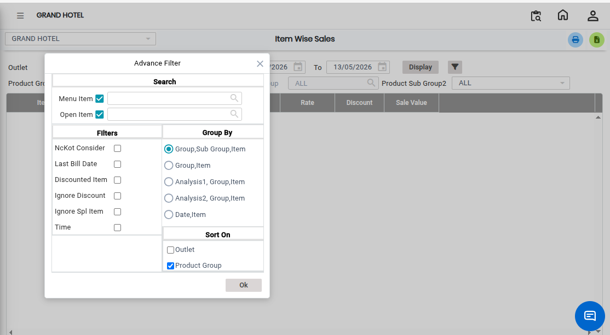
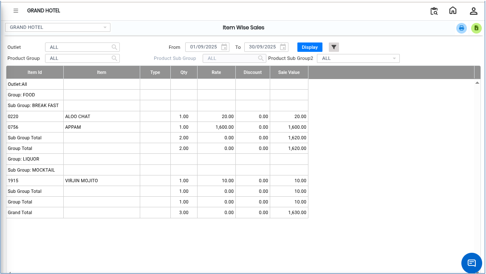

# Item Wise Sales

The **Item Wise Sales Report** provides detailed sales information for items sold during a selected period. This report helps users analyze item performance by displaying sales quantity, cost value, sales value, and discount value for each item.

## Steps to Open the Item Wise Sales Report

Step 1: Navigate to the **Point of Sale** module and click the **Advanced Reports** menu.

1. Select **Item Wise Sales**

* The **Item Wise Sales** screen will be displayed.

Step 2: Choose the additional options that you want to include in the report.

1. Select the required filter options based on your reporting needs.

Step 3: Sort the Report Data:

1. The system allows users to sort the report data for easier analysis.
2. Click on the required column heading or sorting option to arrange the data in ascending or descending order.

<figure><figcaption></figcaption></figure>

Step 4: After selecting the required filters and sorting options, click on the **Display** button.

1. The Item Wise Sales Report will appear on the screen.

<figure><figcaption></figcaption></figure>
