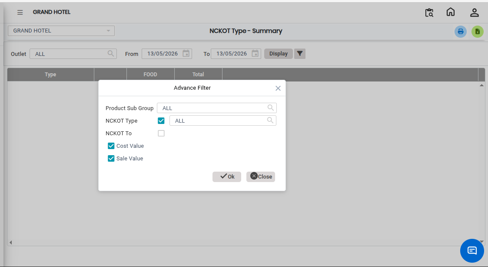

# NC KOT Type Summary

The **NC KOT Type – Summary** report provides a consolidated summary of all Non-Chargeable (NC) KOT transactions categorized by NC KOT type. This report helps users analyze NC KOT activities in a summarized format for better monitoring and reporting.

Using this report, users can generate outlet-wise NC KOT summary reports and review the total count and values associated with each NC KOT type.

## Steps to View the NC KOT Type – Summary Report

Step 1: Navigate to the **Point of Sale** module and click the **Advanced Reports** menu.

1. Select **NC KOT Type – Summary**

* The **NC KOT Type – Summary** report screen will open.

Step 2: Select Advanced Filter Options

* Users can apply advanced filters based on their reporting requirements before generating the report.

<figure><figcaption></figcaption></figure>

Step 3: After selecting the required filter options, click the **Display** button.

1. The system will generate the **NC KOT Type – Summary Report**.

<figure><figcaption></figcaption></figure>
