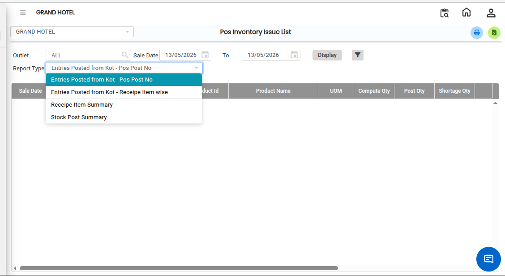
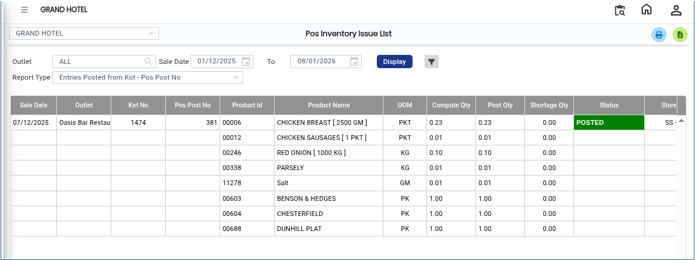

# POS Inventory Issue List

The **POS Inventory Issue List Report** provides detailed information about inventory items issued through the POS system. This report helps users track issued inventory records, monitor stock movement, and review issue-related transactions.

## Steps to View the POS Inventory Issue List

Step 1: Navigate to the **Point of Sale** module and click the **Advanced Reports** menu.

1. Select **POS Inventory Issue List**
2. The **POS Inventory Issue List** screen will be displayed.

Step 2: On the report screen, click on the **Report Type** option.

1. Choose the required report type from the available options.

<figure><figcaption></figcaption></figure>

Step 3: After selecting the required report type, click on the **Display** button.

* The POS Inventory Issue List Report will appear on the screen.

<figure><figcaption></figcaption></figure>
