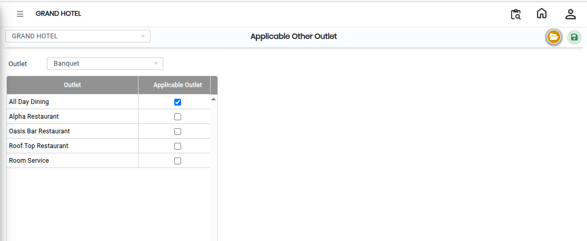
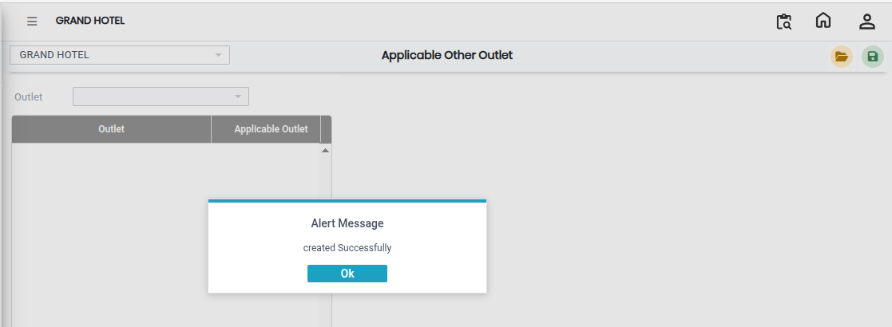

# Applicable Other Outlets

The **Applicable Other Outlet** screen is used to map or assign other outlets to a selected outlet in the system. Using this screen, users can select an outlet and define the related or applicable outlets for operational purposes.

## Steps to Open Applicable Other Outlet

Step 1: Navigate to the **Point of Sale** module and select **Masters1**.

1. Click on **Applicable Other Outlet**.

* The Applicable Other Outlet screen will open.

Step 2: In the Applicable Other Outlet screen, click on the **Open** button.

* The outlet configuration window will appear.

Step 3: Locate the **Outlet Name** field.

1. Select the required outlet from the available list.

* The selected outlet will be used as the primary outlet for configuration.
* Ensure the correct outlet is selected before proceeding.

<figure><figcaption></figcaption></figure>

Step 4: After selecting the outlet name, locate the **Other Outlet** section.

1. Select the required other outlet(s) from the available options.

* The selected outlets will be linked or mapped to the primary outlet.
* Verify all selected outlets carefully before saving.

Step 5: Save the Settings

1. After completing the outlet selection, click on the **Save** button.

* The applicable other outlet configuration will be successfully saved in the system.

<figure><figcaption></figcaption></figure>
