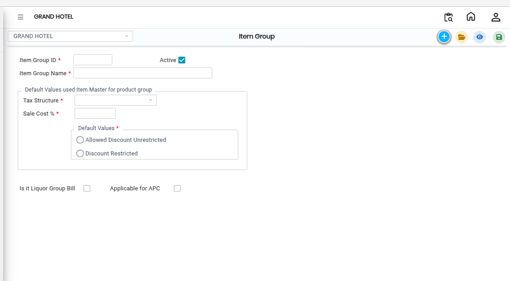

# Item Group

An **Item Group** is a master classification used to organize items into main categories. It helps in grouping similar items together for better management, reporting, and easy selection while creating items in the system.

### Steps to Create Item Group

1\. Navigate to the **Point of Sale** module and select **Masters1**.

* Click on **Item Group**
* The Item Group screen will appear

<figure><figcaption></figcaption></figure>

2.Click on the **New**.png>)button to create a new Item Group.

3\. Enter the **Item Group Name** in the provided field.

* The name should clearly represent the category of items it will include.

4\. Choose the appropriate **Tax Structure** from the available list.

* The tax structure defines the tax rules applicable to all items under this group.

5\. After entering all required details, click on the **Save** button..png>)

* The system will create and store the new Item Group successfully.

<figure><figcaption></figcaption></figure>
