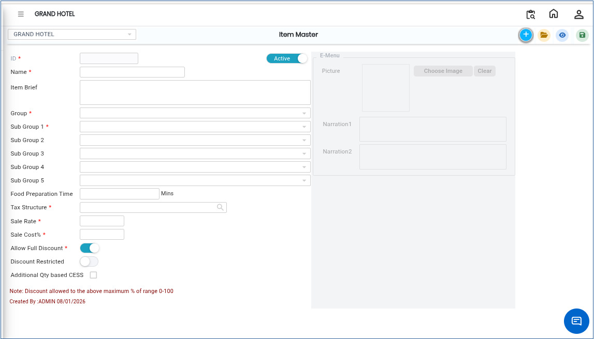

# Item Master

The **Item Master** is a central record used to create and manage all items in the system. It stores important details such as item name, group, sub-group, tax structure, and rate. Once an item is created in the Item Master, it can be used across transactions like purchase, sales, inventory, and billing.

### Steps to Create an Item in Item Master

1. Navigate to the **Point of Sale** module and select **Masters1**.

* Click on **Item Master**
* The Item Master screen will appear.

<figure><figcaption></figcaption></figure>

2\. Click on the **New**.png>)button to start creating a new item.

3\. In the item creation screen, enter the **Item Name.**

* Ensure the name is clear and unique for easy identification.

4.Use the **Check** button to verify whether the item already exists in the system.

* If the item already exists, do not create a duplicate entry.

5\. After confirming the item does not exist, select the **Item Group.**

* The item group helps classify the item under a major category.
* Use the available drop down list to choose the correct group.

6.After selecting the item group, choose the **Item Sub Group 1.**

* This further classifies the item into a more specific category.

7\. Next, select the appropriate **Tax Structure.**

* This defines the applicable tax rules for the item during transactions.

8\. Enter the **Item Rate** in the given field.

* Ensure the rate is accurate as it will be used in billing and pricing calculations.

9\. After entering all required details, click the **Save** button..png>)

* The system will create and store the new item in the Item Master.

<figure><figcaption></figcaption></figure>
