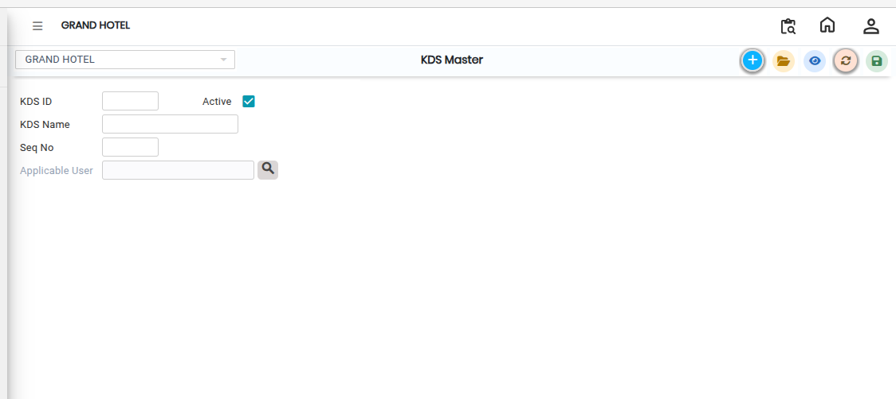

# KDS Master

**KDS Master (Kitchen Display System Master)** is used to configure and manage kitchen display screens in the POS system.

* It helps the kitchen staff view all incoming **Kitchen Order Tickets (KOTs)** on a digital display instead of printed tickets.

## Steps to Create / Open KDS Master

Step 1: Navigate through the menu using the following path:

1. **Point of Sale module→ Masters1 → KOT → KOT Table.**
2. The KDS Master screen will appear.

Step 2: On the screen:

1. Click the **New** button.
2. A new entry form will open.

This allows the user to add a new KDS configuration.

<figure><figcaption></figcaption></figure>

Step 3: Fill in the required fields:

1. Enter a unique identification code for the KDS screen(KDS ID).
2. Enter the name of the KDS display(KDS Name).

* Enable the **Active** option to activate the KDS.
* This ensures the KDS is available for live order display.

Step 4: After entering all details:

1. Review the information carefully.
2. Click the **Save** button.

The system will successfully create and activate the KDS Master entry.
