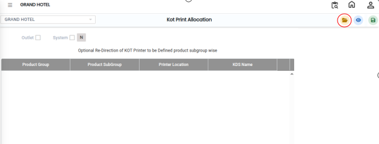
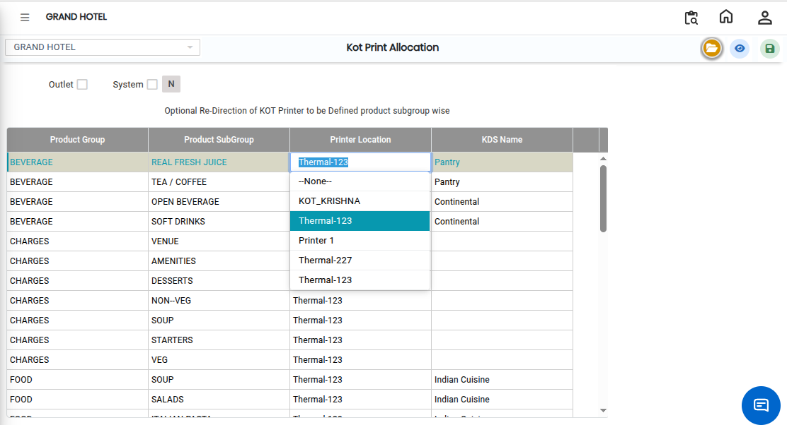
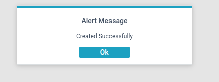

# KOT Printer Allocation

**KOT Printer Allocation** is a feature used to assign specific **KOT Printers to product groups** in a restaurant management system.

This means that when an order is placed, the system automatically sends the Kitchen Order Ticket (KOT) to the correct printer based on the type of product ordered.

## Steps for KOT Printer Allocation

Step 1: Navigate through the menu using the following path:

1. **Point of Sale module→ Masters1 → KOT → KOT Table**
2. The KOT Printer Allocation screen will open.

Step 2: On the screen:

1. Click the **Open** button.
2. The system will display the allocation setup interface.

<figure><figcaption></figcaption></figure>

Step 3:After opening the screen:

* Click on the **Printer Location** field.
* A list of all **created KOT printers** will be displayed.

Select the required printer from the list.

<figure><figcaption></figcaption></figure>

Step 4: After selecting the printer location:

1. Choose the **Product Group** that should be linked to that printer.
2. Product groups are typically categorized based on menu items.

This ensures correct routing of KOTs based on item type.

Step 5: Once all mappings are completed:

1. Review the selected printer and product groups.
2. Click the **Save** button.

The system will update and store the printer allocation settings successfully.

<figure><figcaption></figcaption></figure>
