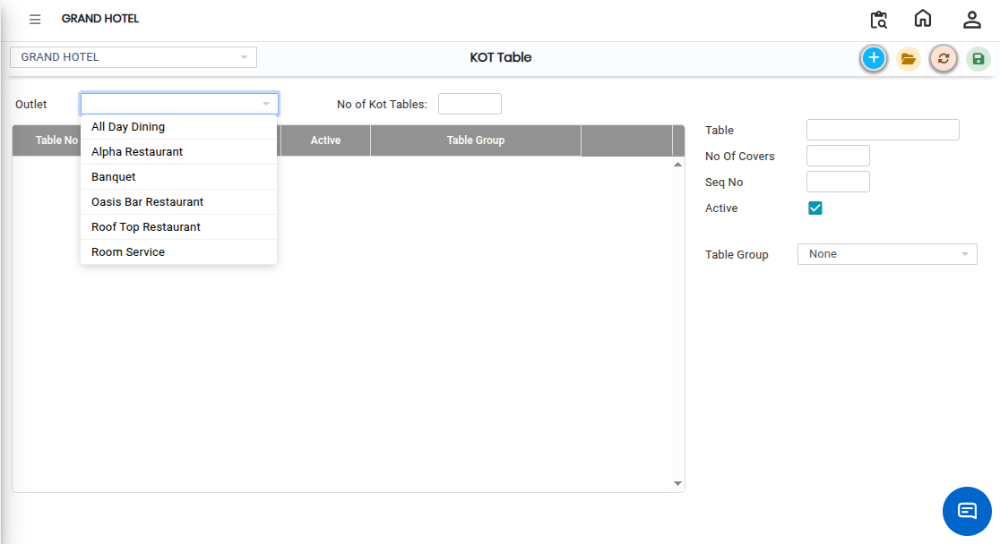

# KOT Table

A **KOT Table** refers to the table setup used in the **Kitchen Order Ticket (KOT)** process in restaurant management systems.\
It helps users define and manage dining tables within an outlet so that orders can be assigned correctly during billing and kitchen operations.

## Steps to Create a KOT Table

Step 1: Navigate through the menu using the following path:

1. **Point of Sale module→ Masters1 → KOT → KOT Table**
2. Once the screen opens, click the **New** button.

Step 2: After clicking **New**, the system will display the outlet selection screen.

1. Select the required **Outlet** from the list.
2. Click **OK** or proceed to the next screen.

This ensures that the table is created under the correct outlet or branch.

<figure><figcaption></figcaption></figure>

Step 3: After selecting the outlet, enter the following details:

1. Enter the **Table Name or Table Number**.
2. Enter the No. of Covers (seating capacity of the table).
3. Enter the sequence number for table arrangement and display order.

This helps the system arrange tables in proper order.

Step 4: Choose the required **Shape (TPOS)** for the table layout.

* The shape represents how the table will appear in the Touch POS (TPOS) screen.

Step 5: After entering all details:

1. Verify the information entered.
2. Click the **Save** button.

* The system will successfully create the new KOT Table.

<figure><figcaption></figcaption></figure>
