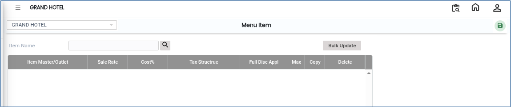
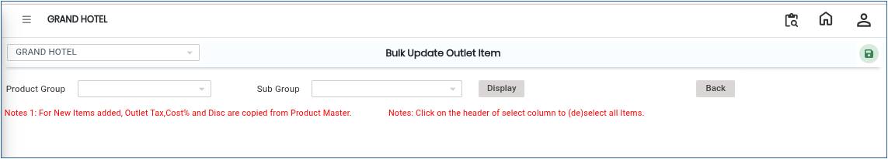

# Menu Item

A **Menu Item** is used to define and manage items that will be displayed in a menu structure. It helps in linking existing items to a menu so they can be used for ordering, billing, or display purposes in the system.

### Steps to Create a Menu Item

1. Navigate to the **Point of Sale** module and select **Masters1**.

* Click on **Menu Item.**
* The Menu Item screen will appear.

<figure><figcaption></figcaption></figure>

2\. Click on the **New** button to create a new Menu Item.

3\. Click on the **Search Icon.**

* Select the required **Item Name** from the list.
* This links the menu item with an existing item in the system.

4\. After selecting the item, click on the **Save** button.

* The Menu Item will be created successfully.

<figure><figcaption></figcaption></figure>

5\. Click on **Bulk Update.**

* A new screen will appear.

<figure><figcaption></figcaption></figure>

6\. Choose the required **Product Group.**

* Click on the **Display** button.
* The system will show all items under the selected group.

7\. Make the required changes in bulk for menu items.

* After updating, click on the **Save** button.
* All changes will be saved successfully.
