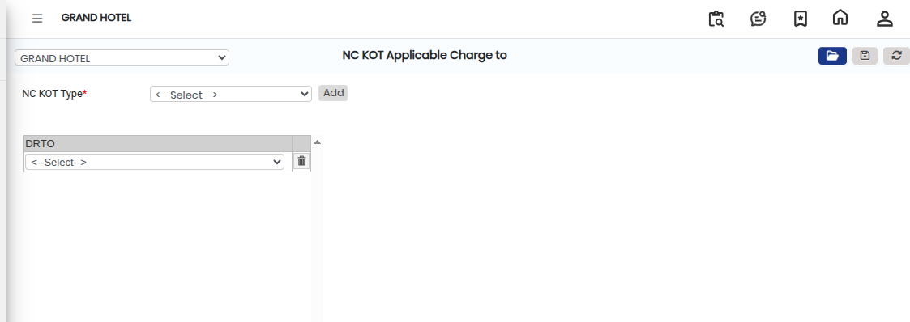
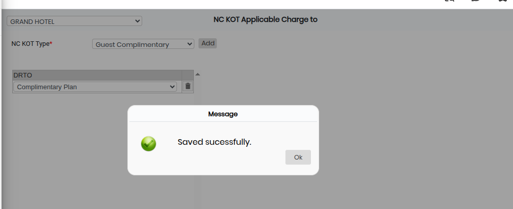

# NC KOT Applicable Charge

The **NC KOT Applicable Charge** screen is used to define and manage applicable charges for NC KOT (Non-Chargeable Kitchen Order Ticket) types.\
Using this screen, users can select an NC KOT Type and assign applicable DRTO (Delivery/Service charge options or defined charge types) based on business requirements.

## Steps to Open NC KOT Applicable Charge

Step 1: Go to **Master1** from the main menu.

1. Click on **NC KOT Applicable Charge**.

* The NC KOT Applicable Charge screen will open.

Step 2: In the NC KOT Applicable Charge screen, click on the **Open** button.

* The configuration window will appear.

<figure><figcaption></figcaption></figure>

Step 3: Click on the **NC KOT Type** field.

1. Select the required NC KOT Type from the available list.

* This selection defines the type of NC KOT for which charges will be configured.
* Ensure the correct NC KOT Type is selected before proceeding.

Step 4: Click on the **Add** button.

1. From the list, select the required **DRTO** option(s).

* The selected DRTO options will be linked as applicable charges for the chosen NC KOT Type.
* Verify all selections carefully before saving.

Step 5: Save the Settings

1. After completing all selections, click on the **Save** button.

* The NC KOT applicable charge configuration will be successfully saved in the system.

<figure><figcaption></figcaption></figure>
