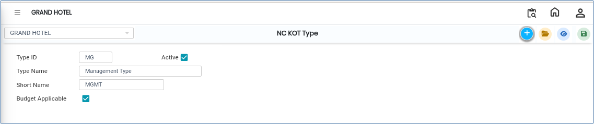

# NC KOT TYPE

The **NC KOT Type** screen is used to create and manage NC KOT (Non-Chargeable Kitchen Order Ticket) types in the system. Using this screen, users can define different NC KOT types by assigning a Type ID and Type Name.

## Steps to Open NC KOT Type

Step 1: Navigate to the **Point of Sale** module and select **Masters1**.

1. Click on **NC KOT Type**.

* The NC KOT Type screen will open.

Step 2: In the NC KOT Type screen, click on the **New** button.

* A new entry form will appear to create a new NC KOT Type.

Step 3: Enter the required details in the respective fields:

* **Type ID**
* **Type Name**

Ensure all details are entered correctly before saving.

<figure><figcaption></figcaption></figure>

Step 4: Save the Record

1. After entering the required information, click on the **Save** button.

* The NC KOT Type will be successfully saved in the system.

<figure><figcaption></figcaption></figure>
