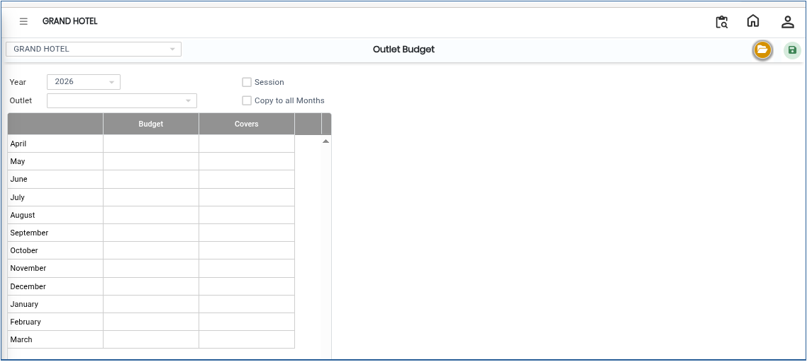
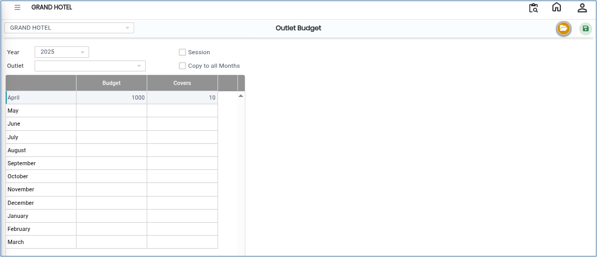

# Outlet Budget

The **Outlet Budget** screen is used to configure and maintain budget details for outlets in the system. Using this screen, users can select the financial year, enter budget values, specify cover details, and save the budget configuration.

## Steps to Open Outlet Budget

Step 1: Navigate to the **Point of Sale** module and select **Masters1**.

1. Click on **Outlet Budget**.

* The Outlet Budget screen will open.

Step 2: In the Outlet Budget screen, click on the **Open** button.

* The budget configuration window will appear.

<figure><figcaption></figcaption></figure>

Step 3: Click on the **Year** icon or selection field

1. A list of available financial years will be displayed.
2. Select the required year for which the budget needs to be configured.

* Ensure the correct financial year is selected before entering the budget details.

Step 4: Enter Budget Information

1. After selecting the year, enter the required:
   * **Budget Amount**
   * **Covers**

* The Budget field is used to define the expected financial target for the outlet.
* The Covers field is used to specify the expected customer count or service covers.

Verify all entered values carefully before saving.

<figure><figcaption></figcaption></figure>

Step 5: Save the Configuration

1. After entering all required details, click on the **Save** button.

* The outlet budget details will be successfully saved in the system.

<figure><figcaption></figcaption></figure>
