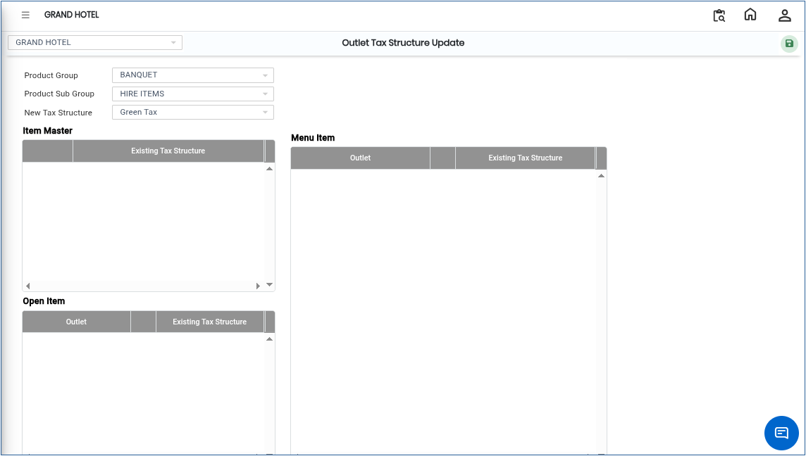
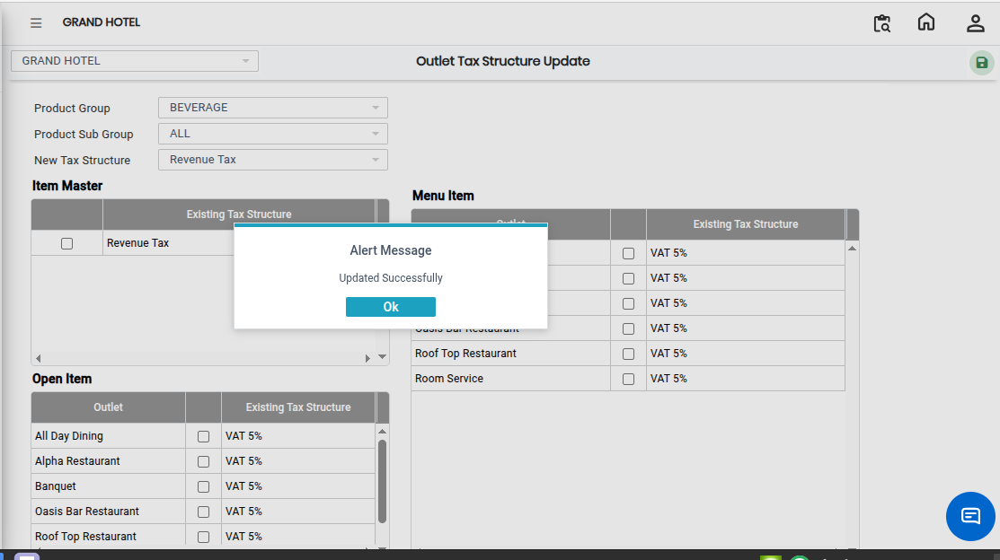

# Outlet Tax Structure Update

The **Outlet Tax Structure Update** screen is used to update and manage tax structures for products in a specific outlet. Using this screen, users can select a Product Group, Product Sub Group, and assign a new tax structure as required.

## Steps to Open Outlet Tax Structure Update

Step 1: Navigate to the **Point of Sale** module and select **Masters1**.

1. Click on **Outlet Tax Structure Update**.

* The Outlet Tax Structure Update screen will open.

Step 2: In the Outlet Tax Structure Update screen, click on the **Open** button.

* The tax structure configuration window will appear.

<figure><figcaption></figcaption></figure>

Step 3: Locate the **Product Group** field.

1. Select the required Product Group from the available list.

* The Product Group is used to categorize products for tax configuration purposes.
* Ensure the correct Product Group is selected before proceeding.

Step 4: After selecting the Product Group, locate the **Product Sub Group** field.

1. Select the required Product Sub Group from the available options.

* The Product Sub Group helps define tax settings more specifically for related products.
* Verify the selected Product Sub Group carefully.

Step 5: Locate the **New Tax Structure** field.

1. Select the required tax structure from the available list.

* The selected tax structure will be applied to the chosen Product Group and Product Sub Group.
* Ensure the correct tax structure is selected to avoid billing and taxation issues.

Step 6: Save the Configuration

1. After completing all selections and configurations, click on the **Save** button.

* The updated tax structure will be successfully saved in the system.

<figure><figcaption></figcaption></figure>
