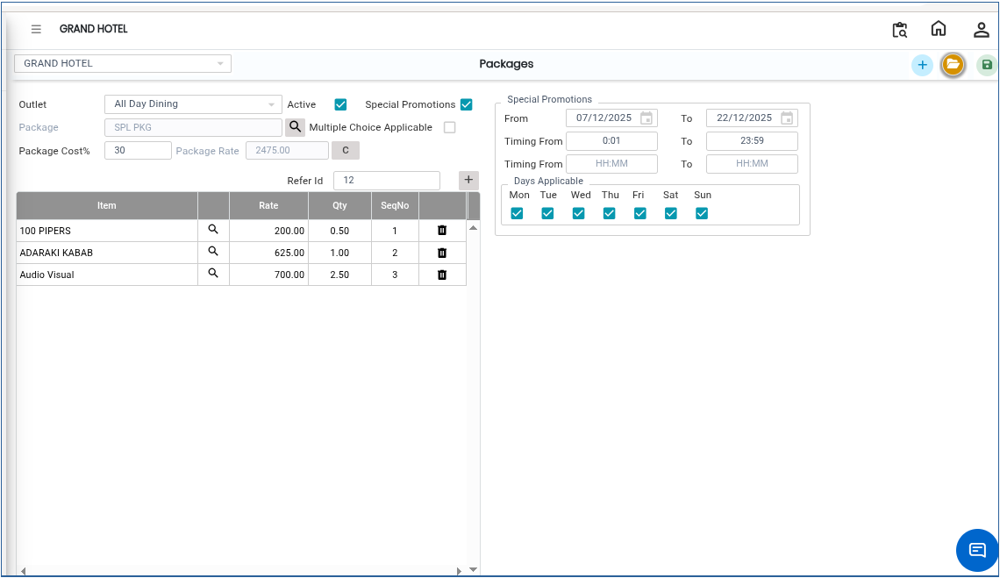

# Packages

The **Packages** module is used to create and manage different package details in the system. Users can add new packages, save package information, and maintain package records for future use.

## Steps to Create Packages

Step 1: Navigate to the **Point of Sale** module and select **Masters1**.

1. Click on **Packages**.

* The Packages screen will be displayed.

Step 2: Click on the **New** button.

* A new package entry screen will appear.

Step 3: Enter Package Details

* Verify the entered details before saving.

The package details screen will appear as shown below.

<figure><figcaption></figcaption></figure>

Step 4: Save the Package

* Click on the **Save** button.

The package details will be saved successfully.

<figure><figcaption></figcaption></figure>
