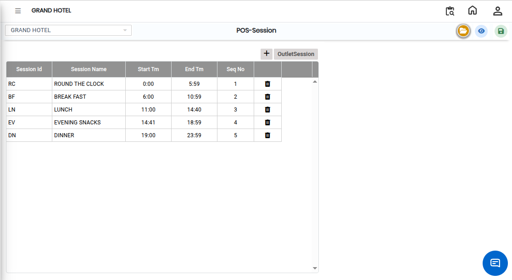
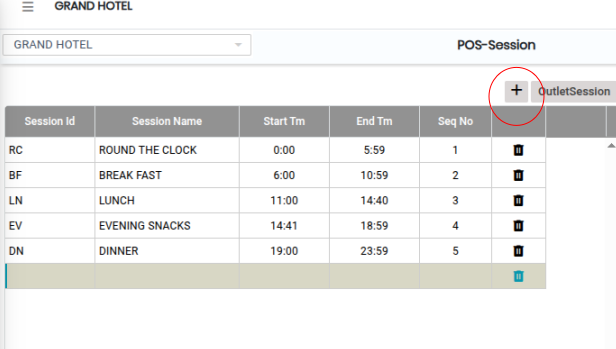
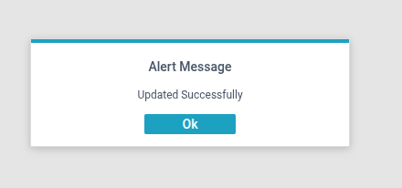

# POS Sessions

The **POS – Session** screen is used to create and manage POS session details in the system. Using this screen, users can add session information such as Session ID and Session Name for POS operations.

## Steps to Open POS – Session

Step 1: Navigate to the **Point of Sale** module and select **Masters1**.

1. Click on **POS – Session**.

* The POS – Session screen will open.

Step 2: Click the Open Button

1. In the POS – Session screen, click on the **Open** button.

* The session configuration window will appear.

<figure><figcaption></figcaption></figure>

Step 3: Click on the **Add** button.

1. Enter the required session details in the respective fields:
   * **Session ID**
   * **Session Name**

* Ensure the entered details are correct before saving.

<figure><figcaption></figcaption></figure>

Step 4: Save the Configuration

1. After entering all required details, click on the **Save** button.

* The POS session details will be successfully saved in the system.

<figure><figcaption></figcaption></figure>
