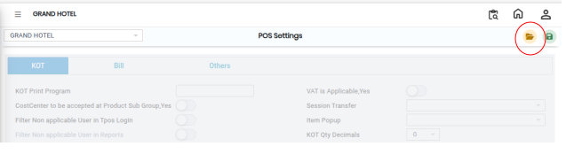
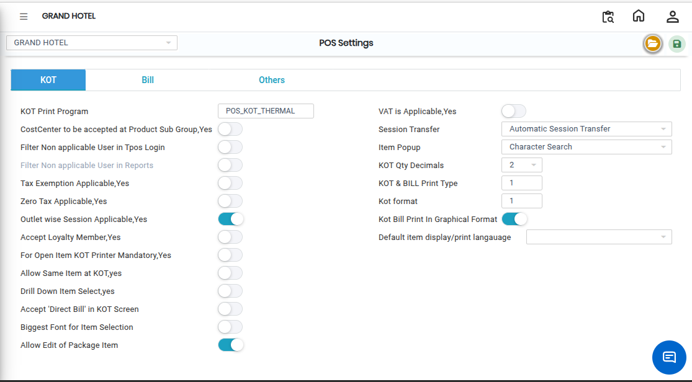
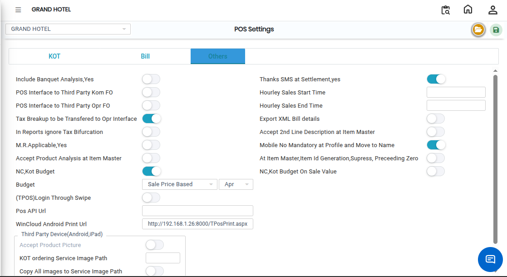

# POS Settings

The **POS Settings** menu is used to configure different settings related to the Point of Sale (POS) system, such as **KOT Settings**, **Bill Settings**, and **Other Settings**.

## Steps to Open POS Settings

Step 1:Navigate to the **Point of Sale** module and select **Masters1**.

Step 2: Click on **POS Settings**.

Step 3: Click on the **Open** button to access the POS Settings configuration screen.

<figure><figcaption></figcaption></figure>

Step 4: Click on the **KOT** button.

* The KOT settings screen will appear.

<figure><figcaption></figcaption></figure>

Step 5: Click on the **Bill** button.

* The Bill settings screen will appear.

<figure><figcaption></figcaption></figure>

Step 6: Click on the **Others** button.

* The Other Settings screen will appear.

<figure><figcaption></figcaption></figure>

Step 7: After completing all the required settings, click on the **Save** button.

* The POS settings will be saved successfully.

<figure><figcaption></figcaption></figure>
