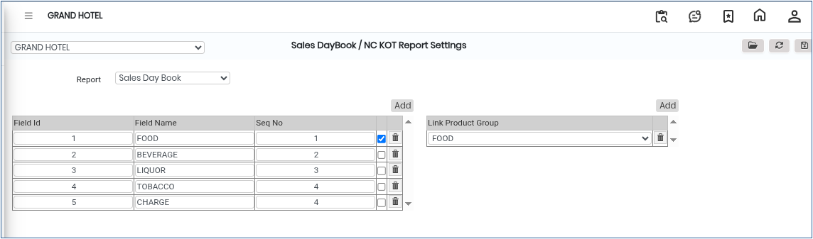
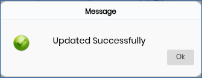

# Sales Day Book / NC KOT Report Settings

The **Sales Day Book / NC KOT Report Settings** screen is used to configure report settings for Sales Day Book and NC KOT reports in the system. Using this screen, users can select the required report type and save the settings for future report generation.

## Steps to Open Sales Day Book / NC KOT Report Settings

Step 1: Navigate to the **Point of Sale** module and select **Masters1**.

1. Click on **Sales Day Book / NC KOT Report Settings**.

* The report settings screen will open.

Step 2: In the Sales Day Book / NC KOT Report Settings screen, click on the **Open** button.

* The settings configuration window will appear.

<figure><figcaption></figcaption></figure>

Step 3: In the settings window, locate the **Report Type** section.

1. Select the required report type from the available options.

* The report type determines how the Sales Day Book or NC KOT report will be generated and displayed.

Step 4: View and Configure the Settings

1. After selecting the report type, the corresponding settings screen will appear.
2. Review the available configuration options carefully.
3. Modify the settings as required.

* Ensure all settings are properly configured before saving.

Step 5: Save the Configuration

1. After completing the required settings, click on the **Save** button.

* The report settings will be successfully saved in the system.

<figure><figcaption></figcaption></figure>
