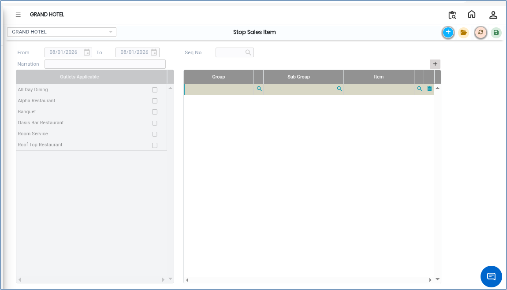

# Stop Sales Item

The **Stop Sales Item** module is used to restrict or stop the sale of specific items in the system. Once an item is marked under Stop Sales Item, it will not be available for sales transactions.

## Steps to Create Stop Sales Item

Step 1: Navigate to the **Point of Sale** module and select **Masters1**.

1. Click on **Stop Sales Item**.

* The Stop Sales Item screen will be displayed.

<figure><figcaption></figcaption></figure>

Step 2: Click on the **New** button.

* A new Stop Sales Item entry screen will appear.

Step 3: Click on the **Group** icon .

* Select the required item from the list.
* Once the item is selected, the selected item details will appear on the screen.

Step 4: Click on the **Save** button.

* The selected item will now be added to the Stop Sales Item list successfully.
