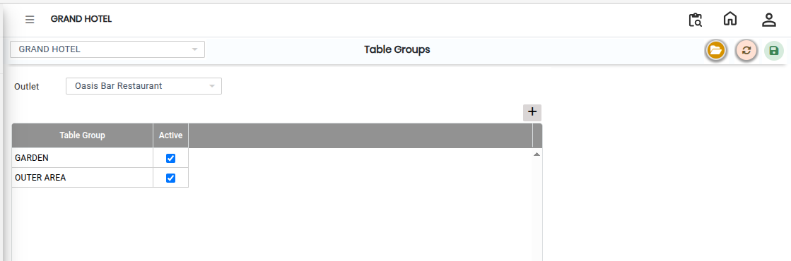
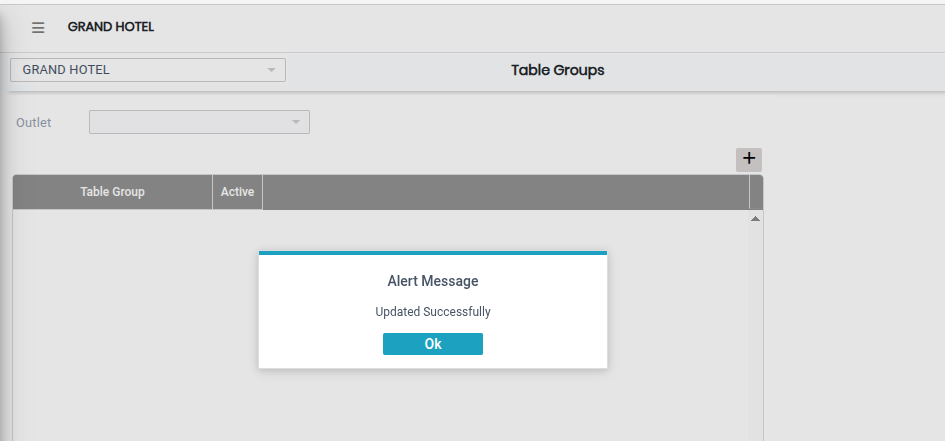

# Table Groups

The **Table Groups** screen is used to assign and manage table groups for a selected outlet in the system.\
Using this screen, users can select an outlet and define which table groups are active for that outlet.

## Steps to Open Table Groups

Step 1: Navigate to the **Point of Sale** module and select **Masters1**.

1. Click on **Table Groups**.

* The Table Groups screen will open.

Step 2: In the Table Groups screen, click on the **Open** button.

* The configuration window will appear.

Step 3: Locate the **Outlet** field.

1. Select the required outlet from the available list.

* The selected outlet will be used to configure table groups.
* Ensure the correct outlet is selected before proceeding.

Step 4: After selecting the outlet, locate the **Active Table Group** section.

1. Select the required table group(s) from the available options.

* These selected table groups will be activated for the chosen outlet.
* Verify all selections carefully before saving.

<figure><figcaption></figcaption></figure>

Step 5: After completing all selections, click on the **Save** button.

* The table group configuration will be successfully saved in the system.

<figure><figcaption></figcaption></figure>
