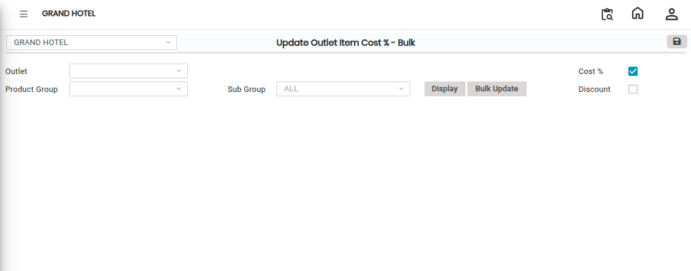

# Update Outlet Item Cost %-Bu

The **Update Outlet Item Cost % – Bulk** feature is used to update the cost percentage or discount percentage for multiple outlet items at the same time. This feature helps users make bulk updates quickly instead of modifying items individually.

## Steps to Create Update Outlet Item Cost % – Bulk

1\. Navigate to the **Point of Sale** module and select **Masters1**.

* Click on **Update Outlet Item Cost % – Bulk.**
* The **Update Outlet Item Cost % – Bulk** screen will appear.

<figure><figcaption></figcaption></figure>

2\. Click on the **New** button to begin the bulk update process.

3. Select the following details from the available options:

* Select the required **Outlet.** This defines where the item cost percentage update will be applied.
* Select the appropriate **Product Group.** This helps filter items based on category.
* Select the corresponding **Sub Group.** This further filters the items for accurate bulk updating.
* After selecting all required details, click on the **Display** button.

4\. Click on the **Discount %** field.

* Enter the required percentage value for the selected items

This percentage will be applied to the displayed outlet items.

5. Click on the **Bulk Update** icon.

* The bulk update screen will appear
* Verify the updated percentage details before saving.

6. After completing the updates, click on the **Save** button.

* The system will successfully update the outlet item cost percentage in bulk.

<figure><figcaption></figcaption></figure>
