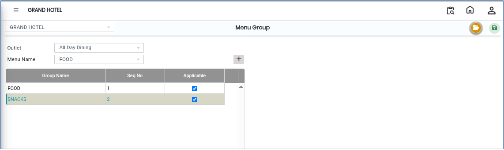

# Menu Group

A **Menu Group** is used to categorize menu items into different groups within the E Menu module. It helps organize menus efficiently for each outlet, making menu management easier and more structured.

### Steps to Create and View Menu Group

Step 1: Navigate to the **Point of Sale** module.

1. Go to **Master2 > E Menu > Menu Group**.

* The Menu Group screen will appear.

Step 2: Click on the **Open** button to proceed.

Step 3: Select the required **Outlet** from the outlet list.

* Click on the **Add** button.
* Enter the **Group Name** in the provided field as shown on the screen.
* Ensure the group name is entered correctly for proper menu classification.

<figure><figcaption></figcaption></figure>

Step 4: After entering the required details, click on the **Save** button to successfully create the Menu Group.
