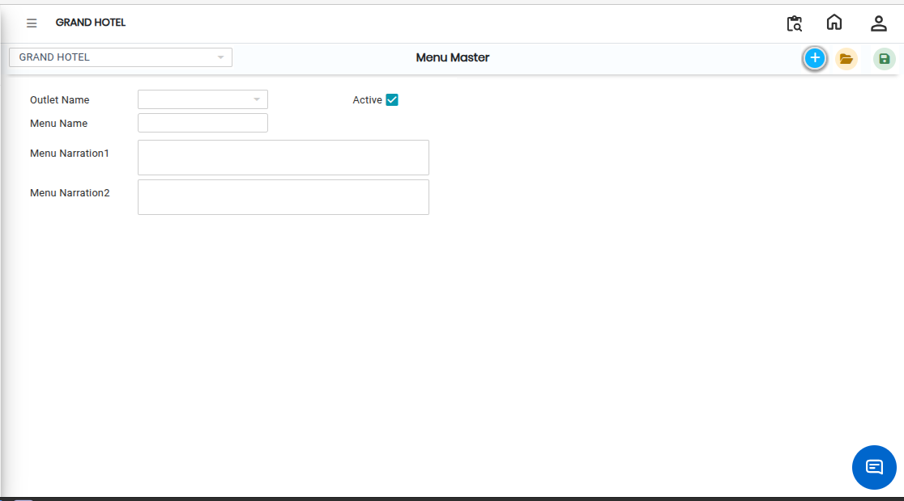

# Menu Master

The **Menu Master** feature in the E Menu module is used to create and manage menus for different outlets. It allows users to assign menu names to specific outlets for easy menu management and display.

### Steps to Create and View Menu Master

Step 1: Navigate to the **Point of Sale** module.

1. Go to **Master2 > E Menu > Menu Master**.

* The Menu Master screen will appear.

Step 2: Click on the **New** button to create a new menu.

Step 3: Click on the **Outlet** field and choose the required outlet name from the list.

* After selecting the outlet, enter the **Menu Name** in the provided field.
* Ensure the menu name is entered correctly for proper identification.

<figure><figcaption></figcaption></figure>

Step 4: After entering all the required details, click on the **Save** button to successfully create the menu.
