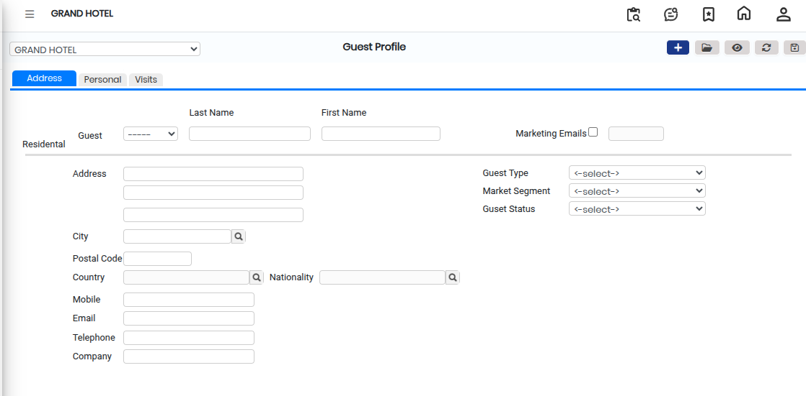
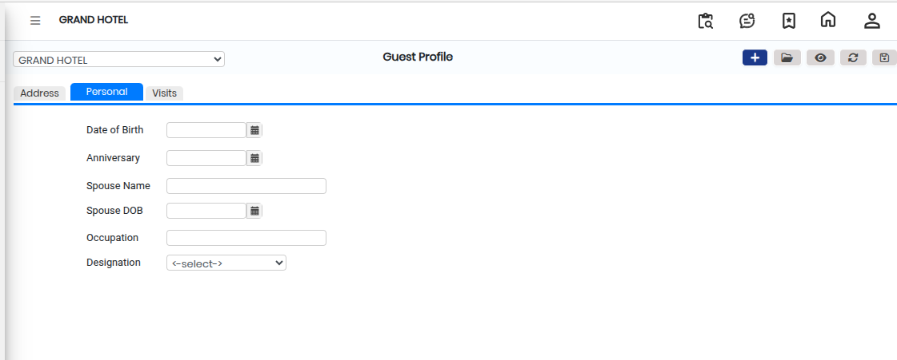
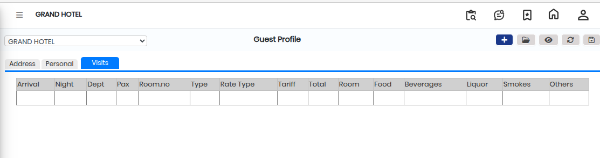

# Guest Profile

A **Guest Profile** is a record created in the system to store complete information about a guest, such as personal details, address, and visit history. It helps in maintaining accurate guest records and tracking guest activities for future reference.

### Steps to Create and View a Guest Profile

Step 1: Navigate to the **Point of Sale** module.

1. Go to **Master2 > Guest Profile.**

Step 2: Click on the **Open** button to proceed.

Step 3: Enter the required guest information in the fields provided.

* After entering the details, click on the **Address** section to view or update the guest’s address details.

<figure><figcaption></figcaption></figure>

Step 4: Click on the **Personal** button to open the personal details screen.

* Enter or verify the guest’s personal information as required.

<figure><figcaption></figcaption></figure>

Step 5: Click on the **Visits** button to view or manage the guest’s visit history.

* This section shows all previous and current visits of the guest.

<figure><figcaption></figcaption></figure>

Step 6: Once all the required details are entered and verified, click on the **Save** button to successfully create or update the Guest Profile.
