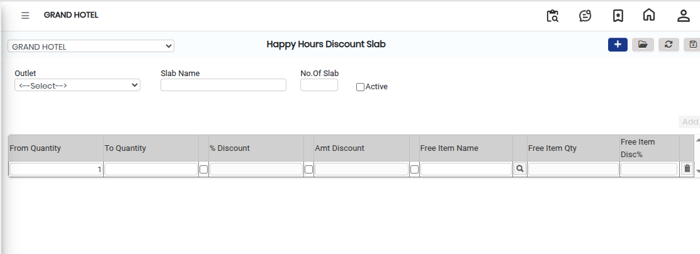

# Happy Hours Discount Slab

A **Happy Hours Discount Slab** is used to define different discount structures under the Happy Hours Discount setup. It helps apply specific discount rules or slabs for selected items, outlets, or time periods during Happy Hours.

### Steps to Create and View Happy Hours Discount Slab

Step 1: Navigate to the **Point of Sale** module.

1. Go to **Master2 > Happy Hours Discount**.

* The Happy Hours Discount screen will appear.

Step 2: Click on the **New** button to create a new Happy Hours Discount Slab.

Step 3: Select the required **Discount Slab** from the available options as shown on the screen.

* Ensure the correct slab is selected based on the discount policy or promotion requirement.

<figure><figcaption></figcaption></figure>

Step 4: After selecting the required Discount Slab, click on the **Save** button to save the details successfully.
