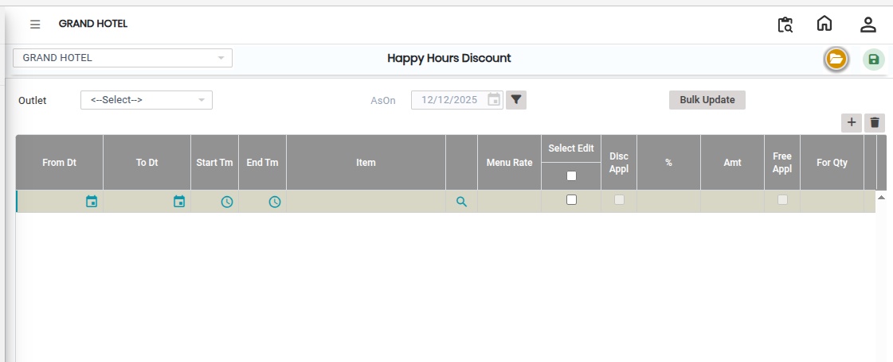

# Happy Hours Discount

A **Happy Hours Discount** is a promotional setup used in the system to apply a percentage-based discount on selected items during specific hours. It helps manage time-based pricing for outlets efficiently.

### Steps to Create and View Happy Hours Discount

Step 1: Navigate to the **Point of Sale** module.

1. Go to **Master2 > Happy Hours Discount**.

Step 2: Click on the **Open** button to proceed.

Step 3: Click on the **Outlet** field to select the outlet where the Happy Hours Discount will be applied.

Step 4: Click on the **Search icon** in the **Item** field.

* A list of available items will appear.
* Select the required item(s) for which the discount should be applied.

Step 5: Enter the **Discount Percentage** in the provided field.

* Make sure the correct percentage is entered as per the promotion rules.

<figure><figcaption></figcaption></figure>

Step 6: After entering all required information, click on the **Save** button to successfully create and store the Happy Hours Discount.
