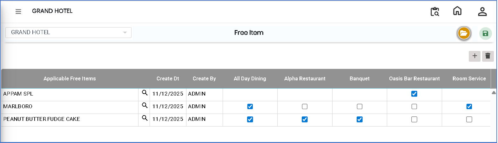
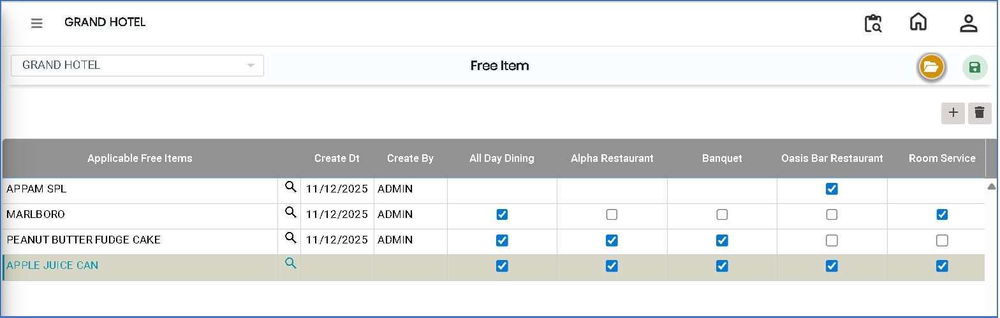

# Free Item

The **Free Item** feature is used to define items that are given free of cost under specific conditions or offers. It helps manage promotional items such as complimentary dishes, offers, or scheme-based free items in the system.

### Steps to Create and View Free Item

Step 1: Navigate to the **Point of Sale** module.

1. Go to **Master3 > Outlet - Free Item**.

* The Free Item screen will appear.

Step 2: Click on the **Open** button to proceed.

<figure><figcaption></figcaption></figure>

Step 3: Click on the **Add** button.

* Select the required **applicable free items** from the list.
* Ensure the correct items are chosen based on the promotion or scheme.

<figure><figcaption></figcaption></figure>

Step 4: Save the Free Item Setup

* After selecting all required free items, click on the **Save** button to successfully store the configuration.
