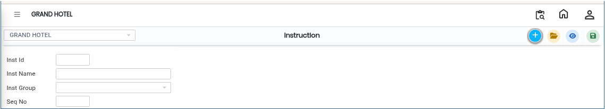
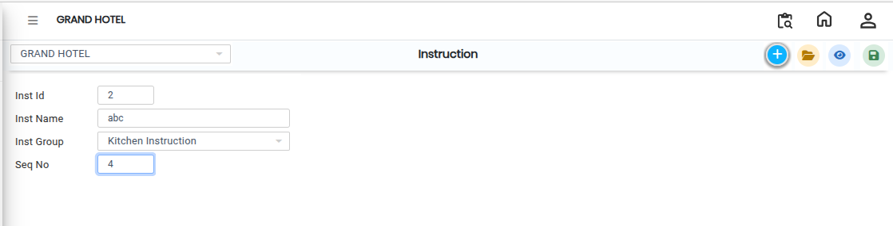

# Instruction

The **Instruction** feature is used to create and manage individual instructions in the system. These instructions provide specific guidance related to items, operations, or service requirements. Each instruction is linked to an Instruction Group for better organization.

### Steps to Create and View Instruction

Step 1: Navigate to the **Point of Sale** module.

1. Go to **Master3 > Instruction**.

* The Instruction screen will appear.

<figure><figcaption></figcaption></figure>

Step 2: Click on the **Add** button to create a new instruction.

Step 3: Enter the required information in the provided fields:

* **Instruction ID** – Enter a unique ID for the instruction.
* **Name** – Enter the instruction name clearly.
* **Group** – Select the appropriate Instruction Group from the list.

Ensure all details are entered correctly before proceeding.

<figure><figcaption></figcaption></figure>

Step 4: Save the Instruction

* After entering all required details, click on the **Save** button to successfully create and store the instruction.
