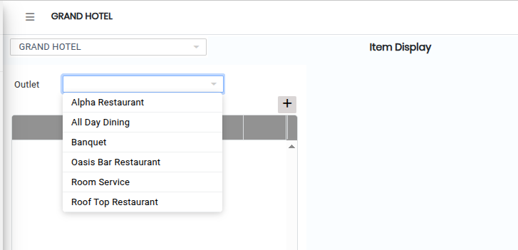
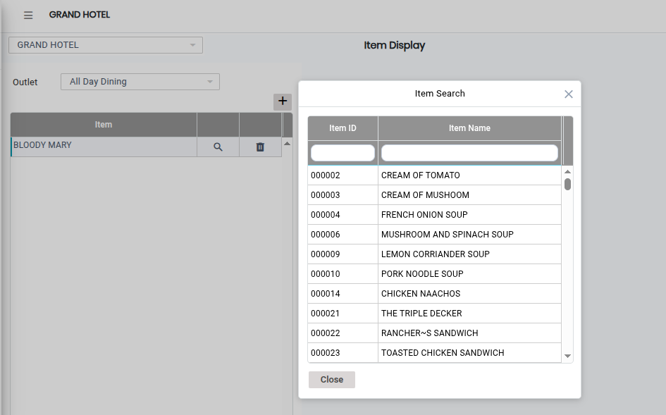
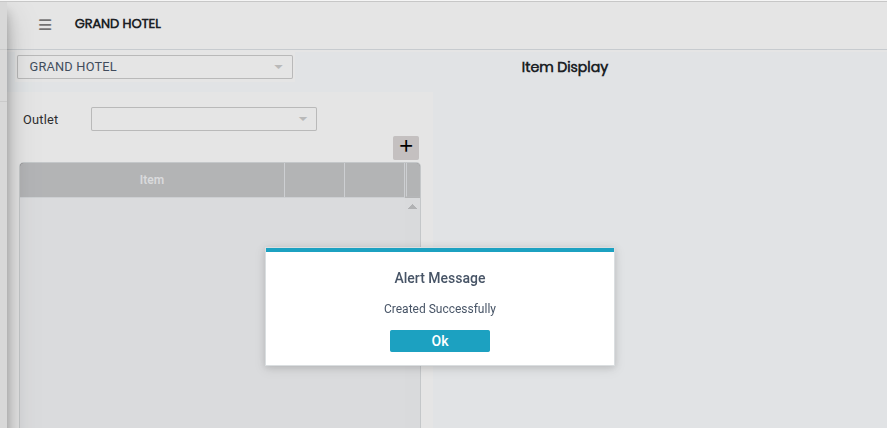

# Item Display

The **Item Display** feature is used to control and manage which items are displayed for a specific outlet. It helps ensure that only selected items are visible and available for display or ordering in the system.

### Steps to Open and Configure Item Display

Step 1: Navigate to the **Point of Sale** module.

1. Go to **Master3 > Item Display**.

* The Item Display screen will appear.

Step 2: Click on the **Open** button to proceed.

Step 3: Click on the **Outlet** field and select the required outlet from the available list.

* Ensure the correct outlet is selected before continuing.

<figure><figcaption></figcaption></figure>

Step 4: Click on the **Add** button.

* Click on the **Search icon** to select items.
* Choose the required items that should be displayed for the selected outlet.

<figure><figcaption></figcaption></figure>

Step 5: Save the Item Display Setup.

* After selecting the required items, click on the **Save** button to successfully store the Item Display configuration.

<figure><figcaption></figcaption></figure>
