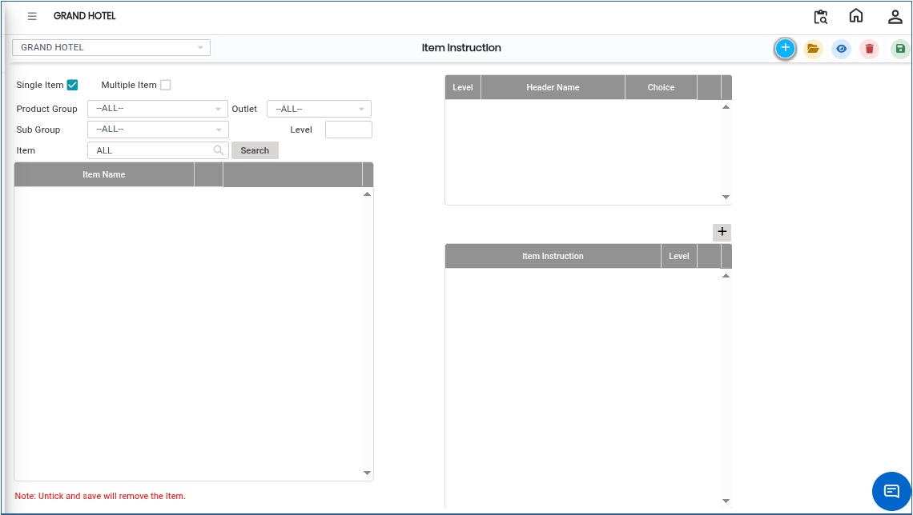
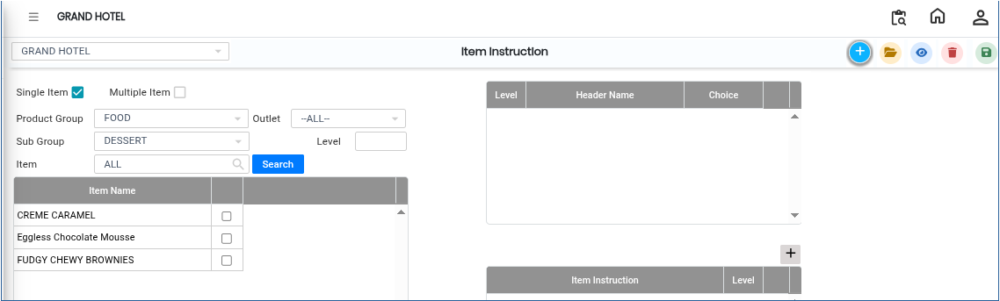

# Item Instruction

The **Item Instruction** feature is used to define specific instructions for individual items in the system. These instructions help guide preparation, serving, or handling requirements for each item, ensuring consistency in operations.

### Steps to Create and View Item Instruction

Step 1: Navigate to the **Point of Sale** module.

1. Go to **Master3 > Item Instruction**.

* The Item Instruction screen will appear.

Step 2: Click on the **Add** button to create a new instruction entry.

Step 3: Select the required details from the available options:

* **Product Group**
* **Sub Group**
* **Item**

After selecting these details, click on the **Search** button.

* The system will display the matching items based on the selected filters.

<figure><figcaption></figcaption></figure>

Step 4: Click on the **Add** button for the required item.

* Enter the **Item Instruction** in the provided field.
* Select the appropriate **Level** for the instruction (based on system configuration or requirement).

<figure><figcaption></figcaption></figure>

Step 5: Save the Item Instruction

* After entering all required details, save the configuration to successfully assign the instruction to the selected item.
