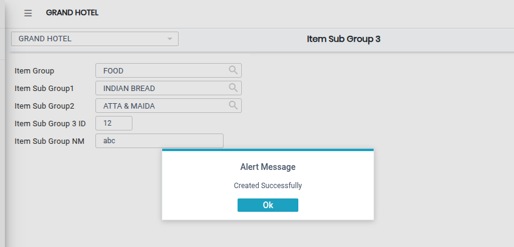

# Item Sub Group 3

The **Item Sub Group 3** feature is used to create a third level of item categorization in the system. It helps in further classifying items under Item Group, Item Sub Group 1, and Item Sub Group 2 for better organization and easy management of items.

### Steps to Create and View Item Sub Group 3

Step 1: Navigate to the **Point of Sale** module.

1. Go to **Master3 > Item Sub Group 3**.

* The Item Sub Group 3 screen will appear.

Step 2: Click on the **Add** button to create a new entry.

Step 3: Select the required **Item Group** from the available list.

* This is the main category under which the sub group will be created.

<figure><figcaption></figcaption></figure>

Step 4: Select Sub Group Levels and Enter ID

1. Select the required **Item Sub Group 1** and **Item Sub Group 2.**
2. Then enter the **Item Sub Group 3 ID** in the provided field.

* Ensure the ID is unique and correctly entered.

Step 5: Save the Item Sub Group 3

* After entering all required details, click on the **Save** button to successfully create the Item Sub Group 3.

<figure><figcaption></figcaption></figure>
