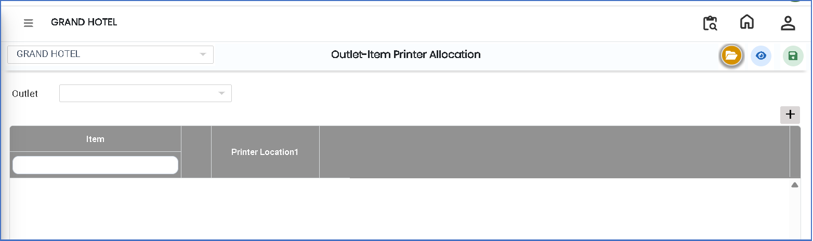
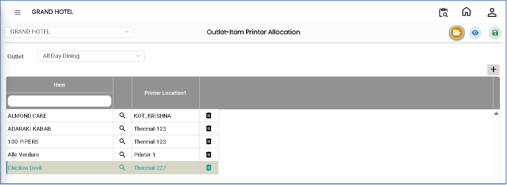

# Outlet - Item Printer Allocation

The **Outlet – Item Printer Allocation** feature is used to assign printers to specific outlets for printing item orders. It ensures that order tickets are printed on the correct printer based on the selected outlet configuration.

### Steps to Create and View Outlet – Item Printer Allocation

Step 1: Navigate to the **Point of Sale** module.

1. Go to **Master3 > Outlet-Item Printer Allocation**.

* The Outlet–Item Printer Allocation screen will appear.

<figure><figcaption></figcaption></figure>

Step 2: Click on the **Open** button to proceed.

Step 3: Click on the **Outlet** field and select the required outlet from the list.

* Click on the **Add** button to create a new printer allocation entry.

Step 4: Select the required **Printer Name** from the available list.

* Ensure the correct printer is selected for the chosen outlet.

<figure><figcaption></figcaption></figure>

Step 5: Save the Allocation

* After selecting the outlet and printer, click on the **Save** button to successfully complete the Outlet–Item Printer Allocation setup.
