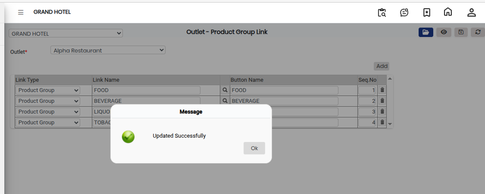

# Outlet - Product Group link

The **Outlet - Product Group Link** feature is used to link product groups to a specific outlet. This helps organize products based on outlet requirements and ensures that the correct product groups are available for each outlet.

### Steps to Open and Configure Outlet - Product Group Link

Step 1: Navigate to the **Point of Sale** module.

1. Go to **Master3 > Outlet - Product Group Link**.

* The Outlet - Product Group Link screen will appear.

Step 2: Click on the **Open** button to proceed.

Step 3: Select the required **Outlet Name** from the list provided.

* Ensure the correct outlet is selected before proceeding.

Step 4: Click on the **Add** button to create a new product group link.

Step 5: Enter the required details in the provided fields:

* **Link Type** – Select or enter the type of link.
* **Link Name** – Enter the name of the product group link.

After entering all the required information, review the details carefully.

Step 6: Click on the **Save** button to successfully save the Outlet - Product Group Link details.

<figure><figcaption></figcaption></figure>
