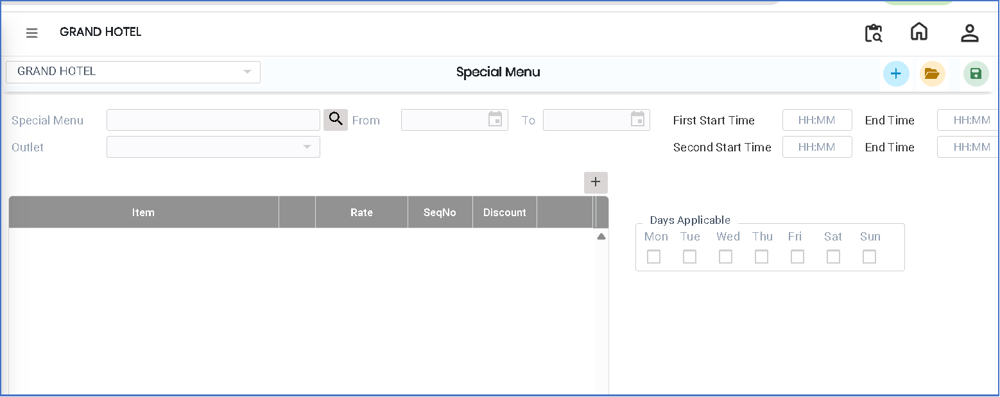
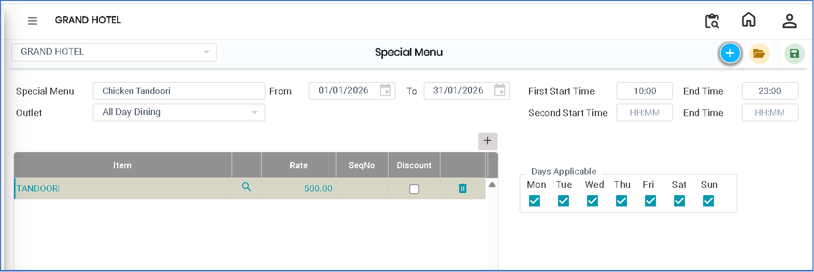

# Special Menu

The **Special Menu** feature is used to create and manage special or customized menus for specific outlets. These menus are typically used for promotions, seasonal offerings, or special events that are not part of the regular menu.

### Steps to Create and View Special Menu

Step 1: Navigate to the **Point of Sale** module.

1. Go to **Master3 > Outlet - Special Menu**.

* The Special Menu screen will appear.

<figure><figcaption></figcaption></figure>

Step 2: Click on the **Add** button to create a new special menu.

Step 3: Enter the required information in the provided fields:

* **Special Menu Name** – Enter the name of the special menu.
* **Outlet** – Select the required outlet from the list.

After selecting the outlet, click on the **Add** option to include the menu details.

<figure><figcaption></figcaption></figure>

Step 4: Save the Special Menu

* After entering all required details and verifying the information, click on the **Save** button to successfully create the Special Menu.

