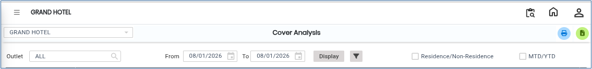
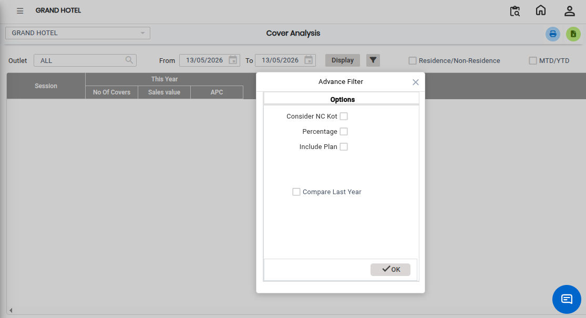
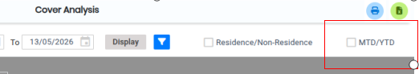
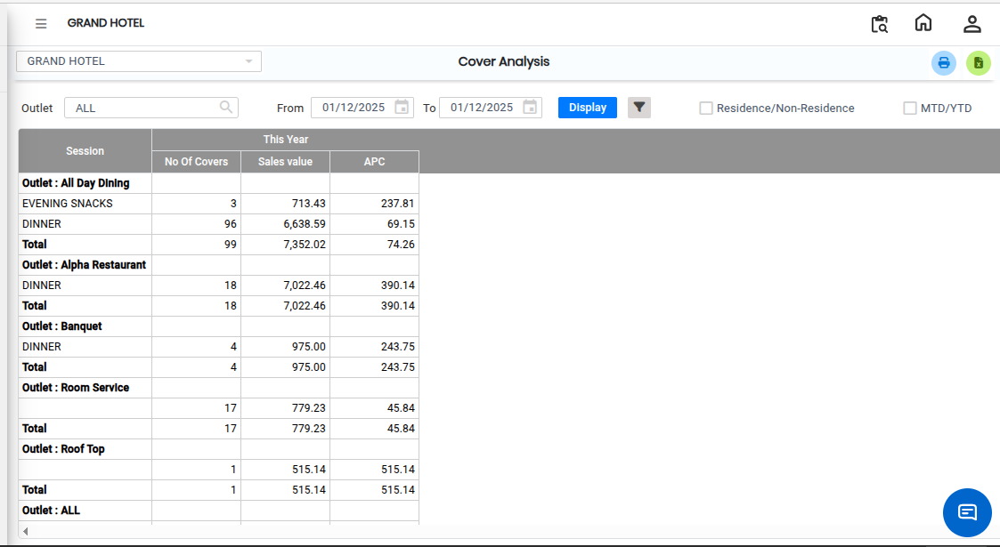

# Cover Analysis

The **Cover Analysis Report** provides detailed information about sales covers on a daily, monthly, and yearly basis. This report helps users analyze the number of packs or covers sold across different sessions and outlets.

## Steps to Open the Cover Analysis Report

Step 1: Navigate to the **Point of Sale** module and click the **Analysis** menu.

1. Select **Cover Analysis.**

* The Cover Analysis screen will be displayed.

<figure><figcaption></figcaption></figure>

Step 2: Choose the additional options that you want to include in the report.

1. Select the required filters and report settings according to your business requirement.

<figure><figcaption></figcaption></figure>

Step 3: Select MTD/YTD Option&#x20;

1. If you select the **MTD/YTD** option:
   * **MTD (Month-To-Date)** generates monthly performance data.
   * **YTD (Year-To-Date)** generates yearly performance data.
2. The system will generate a report based on the selected reporting period.

<figure><figcaption></figcaption></figure>

Step 4: After selecting the required options and filters, click on the **Display** button.

* The Cover Analysis Report will appear on the screen.

<figure><figcaption></figcaption></figure>

If you want to save or download the report in Excel format:

1. Click on the **Excel Export Icon** available on the report screen.
