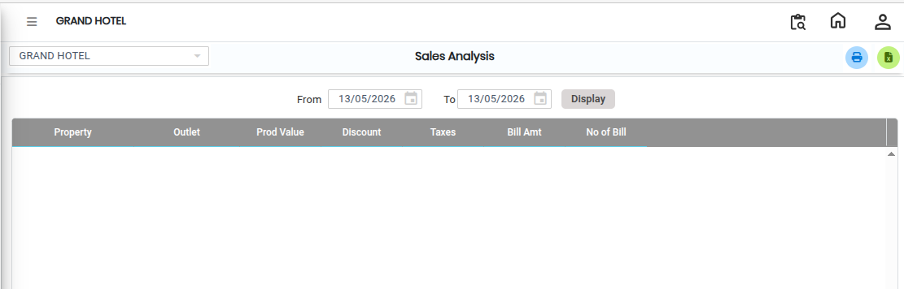
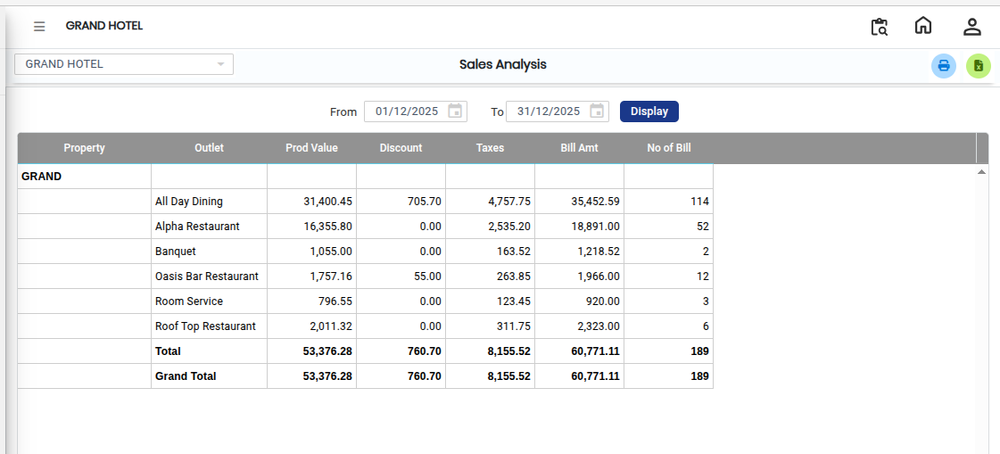

# Sales Analysis

The **Sales Analysis** report is used to view and analyze sales data in a structured format. It helps users review overall sales performance and generate reports based on available data.

## Steps to Open Sales Analysis

Step 1: Navigate to the **Point of Sale** module and click the **Analysis** menu.

1. Select **Sales Analysis.**

* The **Sales Analysis** screen will be displayed.

<figure><figcaption></figcaption></figure>

Step 2: On the **Sales Analysis** screen, click the **Display** button.

1. The report will be displayed on the screen with all relevant sales details.

<figure><figcaption></figcaption></figure>

If the user wants to convert the report into Excel format:

1. Click the **Excel Export** button/icon available on the screen.
