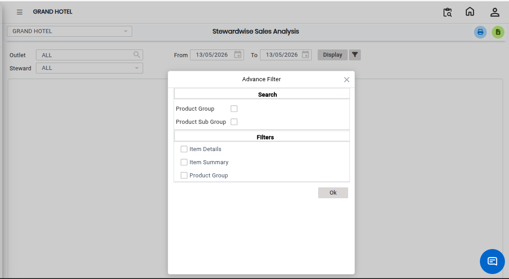
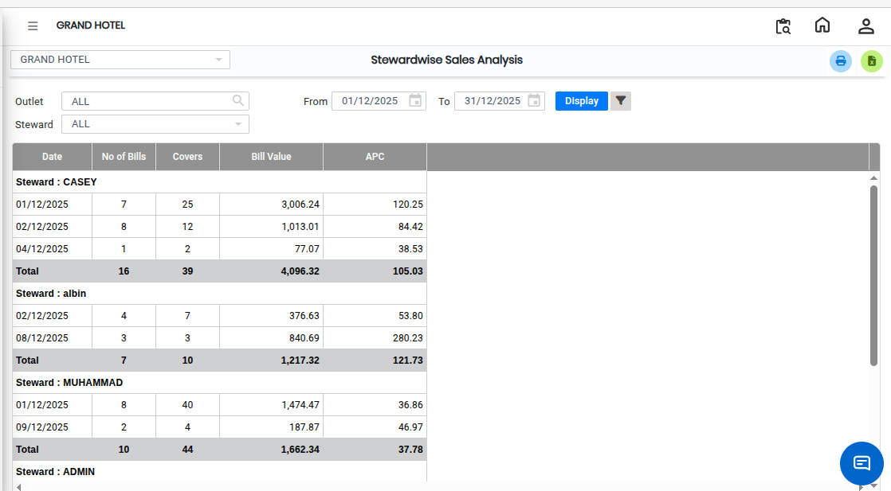

# Stewardwise Sales Analysis

The **Stewardwise Sales Analysis** report helps users analyze and review sales data efficiently. This report allows users to apply advanced filters, display the required data, and export the report to Excel for further analysis.

## Steps to Open Stewardwise Sales Analysis

Step 1: Navigate to the **Point of Sale** module and click the **Analysis** menu.

1. Select **Stewardwise Sales Analysis.**

* The **Stewardwise Sales Analysis** screen will open.

Step 2: On the **Stewardwise Sales Analysis** screen, click the **Advanced Filter** option.

1. Select the required filter values based on your reporting needs.

<figure><figcaption></figcaption></figure>

Step 3: After selecting the required filters, click the **Display** button.

* The system will generate and display the sales analysis report on the screen.

<figure><figcaption></figcaption></figure>

If the user wants to export the report to Excel:

1. Click the **Excel Export** icon/button available on the screen.
