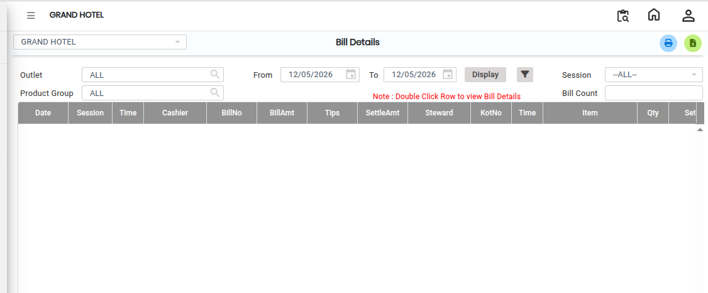

# Bill Details

The **Bill Details Report** helps users view complete billing information for sales transactions. Using this report, you can check Bill Number, Bill Amount, Sales Details, Settlement Details, Outlet-wise Bill Information and Product Group-wise Details.

* This report is useful for reviewing daily sales and settlement records.

## Steps to Open the Bill Details Report

Step 1: Navigate to the **Point of Sale** module and click the **Reports** menu.

1. Select **Bill Details**.

* The Bill Details screen will open.

<figure><figcaption></figcaption></figure>

Step 2: Select Required Filters

1. Outlet-wise Filter

* If you want to view bill details for a specific outlet, select the required **Outlet** from the outlet filter option.

&#x20;2\. Product Group Filter

* You can also filter the report based on **Product Group** to view category-wise billing information.

These filter options help users generate customized reports according to their requirements.

Step 3: Click on the **Advanced Filter** option..png>)

* The Advanced Filter screen will appear, where additional filtering options can be selected for more detailed report generation.

Step 4: After selecting all the required filters, click on the **Display** button.

* The Bill Details Report will load and display the selected billing information on the screen.

<figure><figcaption></figcaption></figure>
