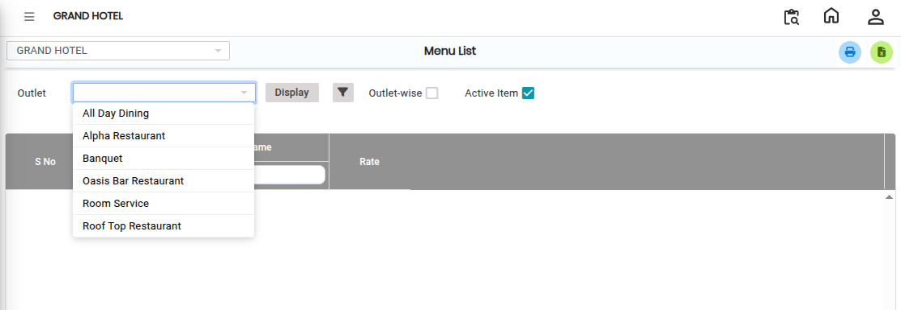
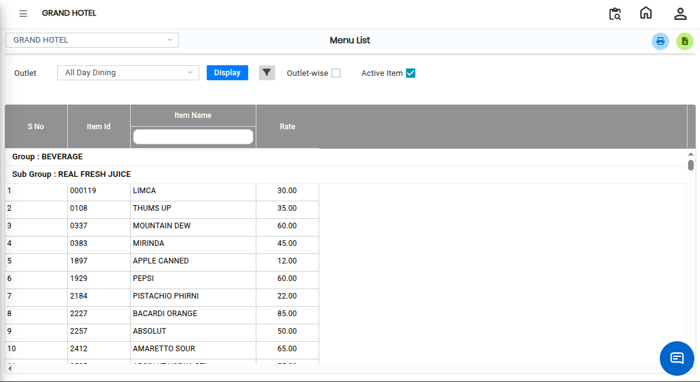

# Menu List

The **Menu List Report** is used to view the complete list of active menus available in each outlet. This report provides detailed information about menu items along with their pricing and tax structure.

## Steps to View Menu List Report

Step 1: Navigate to the **Point of Sale** module and click the **Reports** menu.

1. Select **Menu List**.

* The Menu List Report screen will open.

Step 2: Choose the required **Outlet** for which you want to generate the report.

1. Ensure the correct outlet is selected before proceeding.

<figure><figcaption></figcaption></figure>

Step 3: Select the **Advanced Filter** option based on the required report output.

1. Choose the necessary filter criteria to refine the report data.

* The Advanced Filter helps users customize the report as per their requirement.

<figure><figcaption></figcaption></figure>

Step 4: After selecting all required options, click on the **Display** button.

* The system will generate and display the Menu List Report.

<figure><figcaption></figcaption></figure>

If you want to convert the report into Excel format:

1. Click on the **Excel Export Icon** available on the report screen.
2. The report will be downloaded in Excel format.
