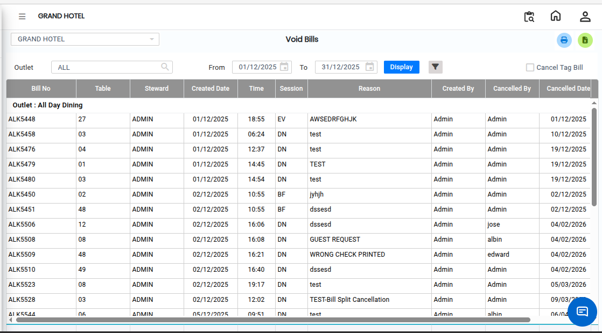

# Void Bill

The **Void Bills Report** is used to view details of cancelled or voided bills. This report helps users track cancelled transactions and review important information related to void bills.

## Steps to Open the Void Bills Report

Step 1: Navigate to the **Point of Sale** module and click the **Reports** menu.

1. Select **Void Bills Report**.

* The Void Bills Report screen will appear.

<figure><figcaption></figcaption></figure>

Step 2: Select Required Filters

1. Outlet-wise Filter

* If you want to view void bill details for a specific outlet, select the required **Outlet** from the outlet filter option.

2. Bill Details Option

* If you want to view detailed information for a particular void bill, select the **Details** checkbox as shown on the screen.

This option allows users to view complete cancellation details, including items, users, and reasons for cancellation.

Step 3: After selecting all the required fields and filters, click on the **Display** button.

* The Void Bills Report will load and display the selected cancelled bill details on the screen.

<figure><figcaption></figcaption></figure>

* If you want to export the report to Excel format, click on the **Excel Export Icon** available on the screen.
