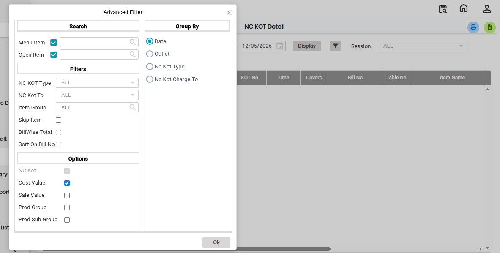
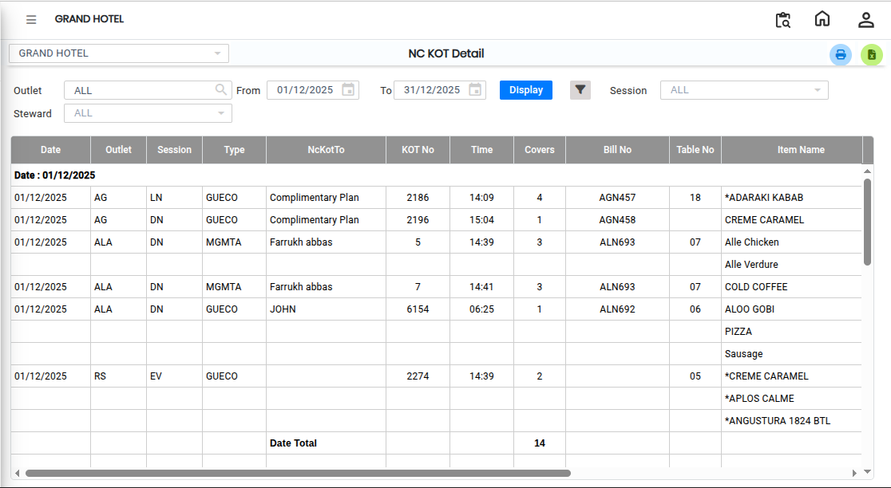

# NC KOT -Detail

The **NC KOT Details** report provides complete information about all NC (Non-Chargeable) KOT transactions recorded in the system. This report helps users monitor and analyze NC KOT activities outlet-wise.

## Steps to View the NC KOT Details Report

Step 1: Navigate to the **Point of Sale** module and click the **Advanced Reports** menu.

1. Select **NC KOT Details.**

* The **NC KOT Details** report screen will open.

Step 2: Select Advanced Filter Options

* Users can apply filters based on their reporting requirements before generating the report.

<figure><figcaption></figcaption></figure>

Step 3: After selecting the required filter options, click the **Display** button.

1. The system will generate the **NC KOT Details Report**.

<figure><figcaption></figcaption></figure>

If the user wants to export the report to Excel:

1. Click the **Excel Export Icon** available on the report screen.
2. The report will be downloaded in Excel format for further analysis or record keeping.
