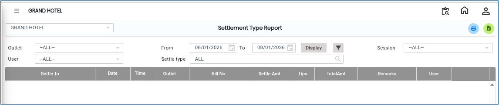
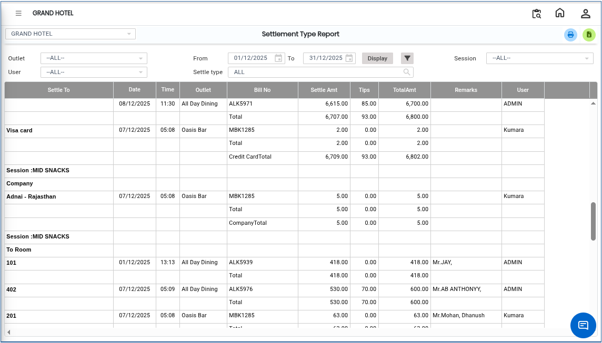

# Settlement Type Report

The **Settlement Type Report** helps users view settlement details based on selected filter options. Users can apply advanced filters, sort the report data, display the report on screen, and export the report to Excel for further analysis.

## Steps to View the Settlement Type Report

Step 1: Navigate to the **Point of Sale** module and click the **Advanced Reports** menu.

1. Select **Settlement Type Report.**

* The **Settlement Type Report** screen will be dispalyed.

<figure><figcaption></figcaption></figure>

Step 2: On the report screen, choose the required **Advance Filter** options.

1. The available filter options help users generate reports based on specific settlement details.
2. Select the appropriate values according to your requirement.

Step 3: Sort the Report Data

1. The system provides sorting options to organize the report data.
2. Click on the required column or sorting option to arrange the data in ascending or descending order.

Step 4: After selecting the filters and sorting options, click on the **Display** button.

1. The Settlement Type Report will appear on the screen with the selected criteria.

<figure><figcaption></figcaption></figure>

* If you want to download or save the report in Excel format:

1. Click on the **Excel Export Icon** available on the report screen.
2. The report will automatically download in Excel format.
