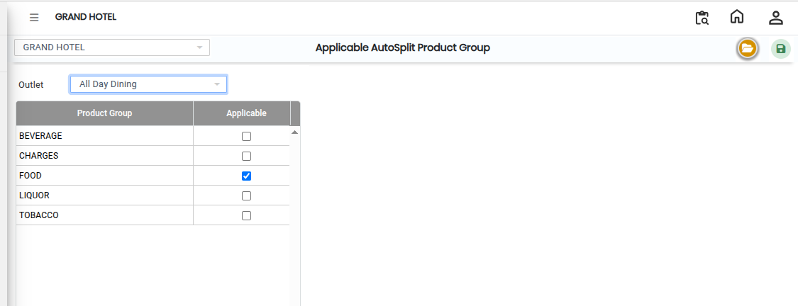
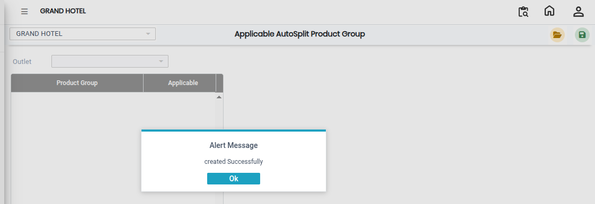

# Applicable AutoSplit Product Group

The **Applicable AutoSplit Product Group** screen is used to assign AutoSplit Product Groups to a specific outlet in the system. Using this screen, users can select an outlet and configure the applicable AutoSplit Product Groups based on operational requirements.

## Steps to Open Applicable AutoSplit Product Group

Step 1: Navigate to the **Point of Sale** module and select **Masters1**.

1. Click on **Applicable AutoSplit Product Group**.

* The Applicable AutoSplit Product Group screen will open.

Step 2: In the Applicable AutoSplit Product Group screen, click on the **Open** button.

* The configuration window will appear.

Step 3: Locate the **Outlet Name** field.

1. Select the required outlet from the available list.

* The selected outlet will be used for AutoSplit Product Group configuration.
* Ensure the correct outlet is selected before proceeding.

Step 4: Click on the **AutoSplit Product Group** field.

1. Select the required product group(s) from the available options.

* The selected AutoSplit Product Groups will be assigned to the chosen outlet.
* Verify all selections carefully before saving.

<figure><figcaption></figcaption></figure>

Step 5: Save the Settings

1. After completing all required selections, click on the **Save** button.

* The AutoSplit Product Group configuration will be successfully saved in the system.

<figure><figcaption></figcaption></figure>
