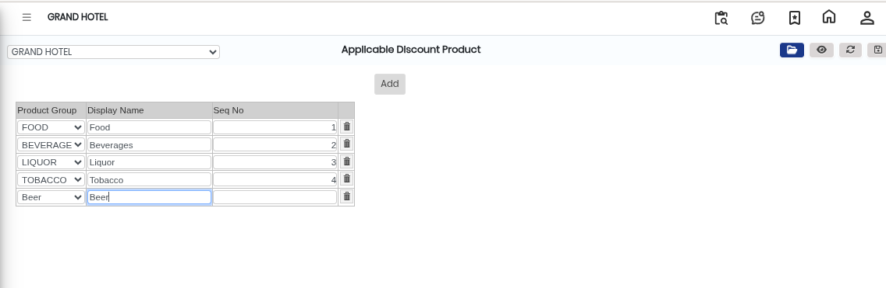

# Applicable Discount Product

The **Applicable Discount Product** screen is used to define and manage products that are eligible for discounts in the system. Using this screen, users can select product groups, assign a display name, and configure discount applicability.

## Steps to Open Applicable Discount Product

Step 1: Navigate to the **Point of Sale** module and select **Masters1**.

1. Click on **Applicable Discount Product**.

* The Applicable Discount Product screen will open.

Step 2: In the Applicable Discount Product screen, click on the **Open** button.

* The discount configuration window will appear.

Step 3: Click on the **Add** button.

1. Enter or select the required details in the available fields:
   * **Product Group**
   * **Display Name**

* The Product Group defines the category of products eligible for discount.
* The Display Name is used to show a user-friendly name for identification.
* Ensure all details are selected correctly before proceeding.

<figure><figcaption></figcaption></figure>

Step 4: Save the Details

1. After entering all required information, click on the **Save** button.

* The applicable discount product configuration will be successfully saved in the system.
