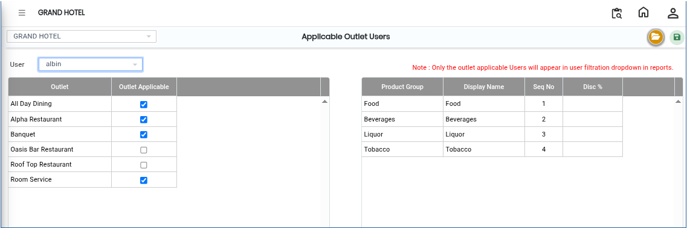
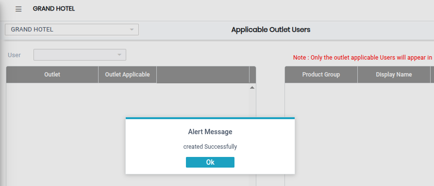

# Applicable Outlet Users

The **Applicable Outlet Users** screen is used to assign outlets to specific users in the system. Using this screen, administrators can select a user and define which outlets are accessible to that user.

## Steps to Open Applicable Outlet Users

Step 1: Navigate to the **Point of Sale** module and select **Masters1**.

1. Click on **Applicable Outlet Users**.

* The Applicable Outlet Users screen will open.

Step 2: In the Applicable Outlet Users screen, click on the **Open** button.

* The user configuration window will appear.

<figure><figcaption></figcaption></figure>

Step 3: Click on the **User** field.

1. A list of available users will appear.
2. Select the required user from the list.

* After selecting the user, the system will display the outlet assignment screen.
* Ensure the correct user is selected before proceeding.

Step 4: In the outlet selection screen, choose the outlets that should be assigned to the selected user.

1. Select the required applicable outlet(s) based on the user’s access requirements.

* The selected outlets will determine which outlets the user can access and operate within the system.
* Verify all selected outlets carefully before saving.

Step 5: Save the Settings.

1. After selecting the applicable outlet(s), click on the **Save** button.

* The outlet assignments will be successfully saved for the selected user.

<figure><figcaption></figcaption></figure>
