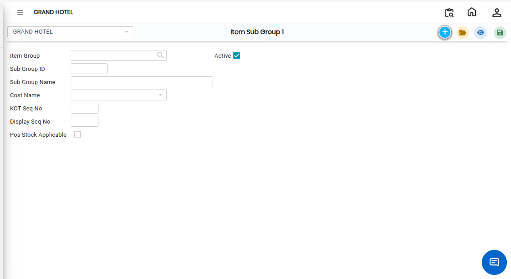

# Item Sub Group 1

**Item Sub Group 1** is a sub-category used to further classify items under an **Item Group**. It helps in organizing items in a more structured and detailed way, making it easier to manage inventory, reporting, and selection during item creation.

### Steps to Create Item Sub Group 1

1\. Navigate to the **Point of Sale** module and select **Masters1**.

* Click on **Item Sub Group 1.**
* The Item Sub Group 1 screen will appear.

<figure><figcaption></figcaption></figure>

2\. Click on the **New** button to create a new Item Sub Group 1 entry.

3\. Choose the **Item Group Name** from the available list.

* This links the sub group to its main group category.

4.After selecting the Item Group, click on the **Save** button.

* The system will successfully create and store the Item Sub Group 1.

<figure><figcaption></figcaption></figure>
